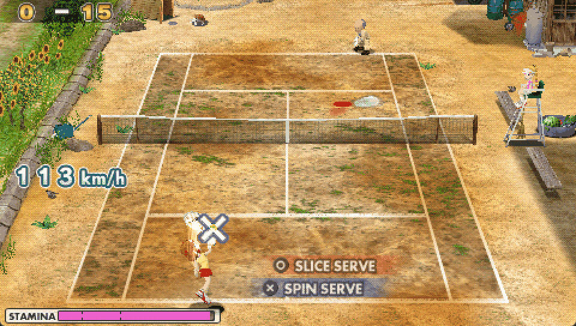

<!-- markdownlint-disable-file MD041 -- the centred header starts with a div -->

<picture>
  <source media="(prefers-color-scheme: dark)" srcset="docs/images/brand/nakagawa-mark-dark.svg">
  
</picture>

# Nakagawa Recomp

**Play PSP games you own as native Windows programs.**

**[Download](https://github.com/Jstar269/nakagawa-recomp/releases/tag/v0.0.1) · [Website](https://jstar269.github.io/nakagawa-recomp/) · [Compatibility](docs/COMPATIBILITY.md) · [Discussions](https://github.com/Jstar269/nakagawa-recomp/discussions) · [Wiki](https://github.com/Jstar269/nakagawa-recomp/wiki)**

Nakagawa Recomp is a static recompiler for the PlayStation Portable. It translates a game's code into C once, before
you play, and compiles it into a Windows program. You supply the game from your own disc. The project is early: one
game is playable, one plays a stage, and the rest are untested.

[Watch a 28-second rally with sound](https://jstar269.github.io/nakagawa-recomp/media/hst-rally.mp4) (MP4, 4.5 MB).

Hot Shots Tennis: Get a Grip belongs to its publisher. This repository contains no game data: you need your own copy of the game, and nothing here downloads one.

## Download

[Download v0.0.1](https://github.com/Jstar269/nakagawa-recomp/releases/tag/v0.0.1), the first release: one 285 MB
ZIP for Windows 11, 64-bit. It includes the build tools, so you don't need to install anything else.

1. Extract the ZIP and start `bin\nakagawa_player.exe`.
2. Drag your game's `.iso` into the player window, or choose **START SETUP WIZARD**. Nakagawa decrypts your own disc
   on your PC, the way PPSSPP does. It never touches firmware.
3. Press **BUILD PACKAGE**, then **PLAY**. A first build takes several minutes.

The ZIP isn't code-signed, so Windows may warn you the first time. The
[release notes](docs/RELEASE_NOTES_v0.0.1.md) say what works, what doesn't yet, and how to check the download.
From v0.0.2, Settings > Updates checks GitHub for a newer version when you ask, and can download and check it for you.

You need:

- Windows 11, 64-bit, with a graphics card that supports Vulkan.
- 8 GB of RAM (16 GB recommended) and 5 GB of free disk space, ideally on an SSD
  ([system requirements](docs/SETUP.md#system-requirements)).
- Your own copy of the game as an uncompressed `.iso` disc image. Nothing here downloads games, firmware or fonts.
  [`docs/YOUR_OWN_GAMES.md`](docs/YOUR_OWN_GAMES.md) covers what to do if a file can't be decrypted.

## Compatibility

| Game | Rating | Notes |
| --- | --- | --- |
| *Hot Shots Tennis: Get a Grip* | Playable | Full matches and Story Mode at the game's own 30 frames per second on the reference PC. Its title file ships with Nakagawa. Movies show black for now ([#1049](https://github.com/Jstar269/nakagawa-recomp/issues/1049)). |
| PAC-MAN Championship Edition | In-game | Reaches its menu and plays a stage, through general fixes with no game-specific code ([#552](https://github.com/Jstar269/nakagawa-recomp/pull/552), [#556](https://github.com/Jstar269/nakagawa-recomp/pull/556)). The rest of the game hasn't been tried. |
| Any other PSP game | Not rated | The player imports it, builds a package and names anything that isn't supported yet. Going straight from your disc to a running game for more titles is in the works ([#308](https://github.com/Jstar269/nakagawa-recomp/issues/308)). |
| Two showcase demos | Playable | Small PSP programs the project wrote as tests. They ship with the release and need no game files. |

These are the ratings the player shows on each game's page. [`docs/COMPATIBILITY.md`](docs/COMPATIBILITY.md) has
the full detail for every game and every part of the PSP. To report how a game runs, post in
[Compatibility reports](https://github.com/Jstar269/nakagawa-recomp/discussions/categories/compatibility-reports).

## How it works

Nakagawa translates the game's MIPS code into C ahead of time and compiles it together with a runtime that stands in
for the PSP's system software, graphics and sound. The player is written in C with SDL3 and Vulkan. The same approach
is behind [Zelda 64: Recompiled](https://github.com/Zelda64Recomp/Zelda64Recomp) (built with
[N64Recomp](https://github.com/N64Recomp/N64Recomp)) and [Unleashed Recompiled](https://github.com/hedge-dev/UnleashedRecomp)
(built with [XenonRecomp](https://github.com/hedge-dev/XenonRecomp)).

- When a game needs something that isn't supported yet, the player stops and names the missing piece.
- No games, firmware or system fonts ship here, and no game data is ever downloaded.
- The player works offline. It connects to the internet only when you agree: to fetch build tools when they
  aren't already present, and to check for updates when you ask ([network use](docs/SETUP.md#network-use)).

[`docs/ARCHITECTURE.md`](docs/ARCHITECTURE.md#pipeline) describes the pipeline, and
[`docs/CODE_TOUR.md`](docs/CODE_TOUR.md) follows one game through the code.

## Build from source

The [prerequisites](docs/SETUP.md#prerequisites) are listed in [`docs/SETUP.md`](docs/SETUP.md): Windows 11 x64
with a Vulkan GPU, PowerShell 7.4+ and MSYS2 UCRT64.

1. Build the player from a checkout: `mingw32-make player`.
2. Start `build\nakagawa_player.exe`, then drag a game's `.iso` into the window or choose **START SETUP WIZARD**.
   Later games go in through the **Add a disc image you own** tile in the library.
3. The player checks the disc. If the game's code is encrypted, Nakagawa decrypts your own disc on your PC into that
   game's folder. If a file can't be decrypted, the player names it and the reason, and you can add a decrypted copy
   from your own disc instead.
4. Press **BUILD PACKAGE**, then **PLAY**. If your PC doesn't have the build tools yet, consent once and the player
   downloads the exact versions it needs.
5. Optional: text uses the project's own open fonts ([#313](https://github.com/Jstar269/nakagawa-recomp/issues/313)).
   For the PSP's original lettering, import the fonts from your own PSP with
   `python tools/nk_cli.py fonts import <folder>`.

Without a game, `mingw32-make player showcase` builds the two showcase demos, and the player lists them on its own.
On Windows this needs WSL 2 and PSPDEV ([steps](docs/SETUP.md#showcase-demos-on-windows-wsl-2-and-pspdev)).

|  |  |
| :---: | :---: |
| **3D Showcase** | **Breakout Showcase** |

Two project-written PSP programs, recompiled and running at the PSP's native 480×272. No commercial game is shown in these two demos, and none is included.

## Matching decompilations

[hst-decomp](https://github.com/Jstar269/hst-decomp) rebuilds the code of Hot Shots Tennis: Get a Grip as C and C++
that compiles back to the original bytes. [lbp-psp-decomp](https://github.com/Jstar269/lbp-psp-decomp) does the same
for LittleBigPlanet on the PSP. Both are source-only and contain no game data.

No decomp source is copied into Nakagawa, which is meant for any PSP game. The decomp's function names can label the
C that Nakagawa generates ([#1495](https://github.com/Jstar269/nakagawa-recomp/pull/1495)), and what it shows about
the game helps replace Nakagawa's Hot Shots Tennis workarounds with general fixes
([#363](https://github.com/Jstar269/nakagawa-recomp/issues/363)).

## Contributing

Testing is the most useful help right now: try a game you own and report how far it gets. Bugs go in
[issues](https://github.com/Jstar269/nakagawa-recomp/issues), and
[good first issues](https://github.com/Jstar269/nakagawa-recomp/labels/good%20first%20issue) are a place to start
on code. [`CONTRIBUTING.md`](CONTRIBUTING.md) has the rules and the checks to run.

[All documentation](docs/README.md) · [Contributing](CONTRIBUTING.md) · [Accessibility](ACCESSIBILITY.md) ·
[Getting help](SUPPORT.md) · [Security](SECURITY.md) · [Code of conduct](CODE_OF_CONDUCT.md) ·
[AI use](docs/AI_USAGE.md)

## Project health

## License and lineage

GPL-3.0-or-later ([LICENSE](LICENSE)); some files keep GPL-2.0-or-later or their upstream terms. The project began as
a fork of [sal063's PSP Recompilation Project](https://github.com/sal063/PSP-recompilation-project) and still contains
code from it and code adapted from [PPSSPP](https://github.com/hrydgard/ppsspp); the ATRAC audio and H.264 video
decoders come from FFmpeg. It is not endorsed by those upstream authors. Details: [NOTICE.md](NOTICE.md) and
[CREDITS.md](CREDITS.md).

## Legal

Nakagawa Recomp is an independent fan project. It is not affiliated with or endorsed by Sony Interactive
Entertainment, Clap Hanz, or any game publisher. PlayStation and PSP are trademarks of Sony Interactive
Entertainment Inc., and game titles are trademarks of their owners; they are named here only to say what the project
works with. This repository contains no game files, firmware or system fonts. Nakagawa decrypts your own disc
locally with the public game key tables PPSSPP ships; it never downloads games and never decrypts firmware.

Rights holders with a concern about anything here can contact the maintainer privately through
[GitHub private reporting](https://github.com/Jstar269/nakagawa-recomp/security/advisories/new) or the contact on
the [maintainer's profile](https://github.com/Jstar269). We aim to respond promptly and will remove material where
appropriate.

## Dedication

Dedicated to Blitzen: One of the greatest pets you could ever have. A companion from beginning to end.

An absolute sweetheart.

2012-2026
