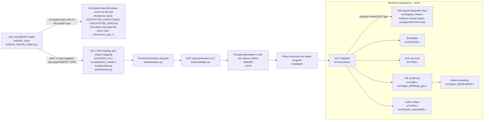

# Architecture Overview

This page is a map of how Nakagawa Recomp turns a PSP game into a native program: what each major part
does, how data flows between them, and where to start looking when something behaves differently from a
PSP. When this page and the code disagree, the live source, Makefile and tests are right.

In short: the tools in `tools/` read the game's program files, find its functions, and translate its MIPS
machine code into C ahead of time (AOT). That C is compiled together with the native runtime in `src/rt/`,
which stands in for the PSP's system software, graphics, sound and input. If the running game reaches valid
code that wasn't translated, a small interpreter runs it, but only inside code the analyzer has claimed;
anything it can't handle stops the run with a named message instead of guessing. The player in
`src/player/` puts it all in front of the user.

New to the code? [`CODE_TOUR.md`](CODE_TOUR.md) follows one game through these parts, file by file, from the
disc image to the first frame on screen.

## Pipeline



The repository does not contain the retail game executable, ISO, decrypted game PRXs, or private
oracle traces. Those remain local inputs.

## PSP core, title profile, and backend boundary

The first wave of this work adds a small, versioned contract between the PSP core, a title's profile and
the host backends, without changing how Hot Shots Tennis (HST) is built today:

```text
validated ProgramImage (tools/prxload.py)
        -> canonical CFG / ownership observation (tools/analyze.py)
        -> psp-core-v1 semantic capabilities
        -> title profile (boot/resources/explicit HLE declarations/input labels)
        -> host backend contracts and optional enhancements
```

The core contract owns Allegrex/VFPU semantics, guest memory, scheduling,
interrupts/callbacks, generic HLE, GE/display/audio semantics, I/O capability
interfaces, backend contracts, and evidence schemas. A title profile may select
boot policy, public resource locators, input labels, and explicit HLE capability
dispositions. Unknown capabilities fail closed; a profile cannot add an implicit
PSP-semantic replacement, and enhancements are disabled by default in the public
profile-zero contract. HST remains an existing manager/build profile and is not
switched to the new adapter wholesale in this wave.

### ProgramImage v1 and CFG ownership observation v1

`ProgramImage` and `CanonicalCfgState` remain observation types, not replacements
for the production analyzer. The legacy `analyze()` path now exposes the
canonical CFG report through opt-in `analyze.py --cfg-report/--cfg-gate` and
`codegen.py --cfg-report/--cfg-gate`; ordinary codegen output and analysis are
unchanged when those flags are absent, and `--cfg-report` alone reports gate-mode
analysis without changing emitted code. `--cfg-gate` checks the primary image and
each supplied extra ELF before code emission. This wiring consumes the legacy
analyzer result. `--cfg-gate` rejects overlapping executable spans and prevents
direct-jump adjacency from seeding a callable. It does not claim equivalence
for, or route production through, `ProgramImage` or `CanonicalCfgState`.

**Precondition for any later production wiring.** Before either type may replace a
production path, it must first be shown *equivalent* to the path it replaces on
real inputs -- not merely self-consistent. `cfg_compatibility_findings()` exists
for exactly this: it reports differences against a legacy entry set and
deliberately does not pick a winner. Wiring either type in without that
equivalence evidence would convert an observation tool into an unverified
reimplementation of the analysis the pipeline already depends on.

`tools.prxload.load_program_image()` is the read-only Wave-1 adapter. It validates the
ELF32 envelope, checked load/file/guest spans, permissions, zero-fill extents, entry,
imports/exports, module metadata, and relocation records before allocating a flat image.
The immutable object carries source name/size/SHA-256, fixed-width guest spans, and
`bytes` payloads; `canonical_program_image_json()` serializes metadata deterministically
and omits raw payload bytes. It deliberately does not apply relocations or replace the
legacy `Prx` loader, so the current HST path remains authoritative while synthetic tests
compare both representations.

`tools.analyze.canonical_cfg_report()` emits schema version 1 as an observation-only
ownership report. Its instruction rows carry address, raw word, opcode identity,
delay-slot attachment, branch-likely annulment, owners and reasons. Edge rows distinguish
direct branches/jumps, calls, tail transfers, fallthrough, delay slots, and unresolved
computed transfers. The report also records interior entries, continuations, ownership
conflicts, jump-table candidates, data spans, padding, unowned executable words, partial/unreadable executable
spans, and explicitly unmapped entry candidates. `verify_canonical_cfg_report()` checks coverage and
structural consistency; `cfg_compatibility_findings()` reports differences from a legacy
entry set without silently selecting a winner. `canonical_cfg_json()` is stable for
fixtures and build-cache comparisons. The CFG gate rejects an owned in-range edge whose
target has no owner, plus ownership conflicts and unmapped entries. Non-padding words
outside known control-flow remain listed as unowned; this records uncertainty and does
not prove that no dynamic entry exists. Dynamic-entry ownership remains in the works
(issue #291); the gate keeps such words visible as unowned instead of assuming the image
is complete. File adjacency after an unconditional transfer
does not make a word a callable. The opt-in `codegen.py --stack-census` flag
also requires the CFG gate and wraps generated callable entries to compare guest
`$sp` at entry and host return. Continuation entries share their callable's census;
flow exits are reported as excluded and keep the result `PARTIAL`, while an
ordinary unexplained stack delta reports `FAILED`. An unobserved workload reports
`NOT_OBSERVED`; a balanced workload that misses generated callable entries reports
`PARTIAL` with `unobserved=N`, so `COMPLETE` requires observing every expected entry.
These diagnostics are source-owned runtime evidence and make no physical PSP
correctness claim. The cosimulation harness classifies its source-owned
`spleak` cell as a positive control and passes only when that cell is the sole observed
mismatch, with its declared 32-byte delta; every other entry must balance. Neither
report is an optimizing IR or a production HST switch.

`assets/titles/synthetic.json` and `synthetic-title2.json` carry the source-owned
`psp-core-v1` / `profile-zero-v1` contract. Their shared PSPDEV fixture points to
`fixtures/profile_zero`; each acceptance case names `profile-zero-e2e` as its
proving gate and retains its declared evidence class. That gate drives both
manifests through ProgramImage, analyzer/AOT package generation, and the headless
production runtime. The fixtures cover the public source route only; broader
title intake remains tracked in issue #309.
Generated output from a source-owned profile may be public in principle, but retail
or private-input-derived AOT remains local, ignored, and outside publication.

### Native title recognition projection

`python tools/title_manifest.py --print-public-catalog` emits an immutable C99
header from the explicitly included manifests in `assets/titles/`. The canonical
validator owns the schema; there is no second native title registry to maintain.
Excluded and unclassified files are not read, missing included files fail, and
symbolic-link/junction input paths are rejected. Run generation on a quiescent
checkout; these checks do not provide filesystem race isolation or provenance
attestation. Capture subprocess stdout as bytes to preserve the generated LF text.

The projection contains only title ID, display name, kind, canonical manifest
SHA-256, and explicit primary/compatible disc IDs. It preserves UTF-8 strings
through C compilation, rejects duplicate identities, and invents no disc IDs for
synthetic or homebrew titles. Native lookups use exact identifiers. The digest
also changes when non-projected manifest fields change; it identifies input
content and does not authorize it.

Recognition is not compatibility, preparation readiness, or permission to launch.
The existing manifest-to-plan and runtime-configuration generators retain those
separate responsibilities. Private overlays require their own explicit local
binding and collision policy in a future host consumer. The current player
prototype is not integrated by this projection. Source-owned tests generate,
compile, and execute the header; no retail input is required.

## Directory Layout

```text
NakagawaRecomp/
├── tools/              # Python offline compilation, verification, and audit tooling
├── src/
│   ├── core/           # Shared native library, title, and launch services
│   ├── player/         # Native player UI and setup staging
│   ├── rt/             # C native runtime
│   │   ├── gpu_sdl3vk/ # SDL3 + Vulkan backend
│   │   └── ...
│   └── ref/            # C++ reference interpreter / differential-test support
├── assets/vfpu/        # Pinned VFPU lookup-table assets with provenance
├── font/               # Pinned replacement PGF fonts with provenance
├── build/              # Generated build output (Git-ignored)
├── docs/               # Maintained documentation and dated investigation records
├── Makefile            # Build driver
├── nk_manager.ps1      # Canonical build/run/inspection orchestration
├── nk.ps1              # Simple build, doctor, and play entry point
└── README.md           # Project entry point
```

## `tools/` — Offline Compilation

These tools run on the development host before the native compiler.

| Script | Input | Output | Purpose |
| --- | --- | --- | --- |
| `prxload.py` | decrypted ELF/PRX | `*_image.bin` | Rebase modules, apply supported relocations, emit flat guest image |
| `imports.py` | ELF + base | `*_imports.toml` | Resolve PSP import NIDs for HLE/codegen |
| `analyze.py` | ELF | in-memory function map | Discover function boundaries/control-flow metadata |
| `codegen.py` | ELF + analysis/import data | `*_recomp.c`, `*_recomp_N.c`, headers/reports | Translate guest MIPS functions into C |

### Codegen internals

`codegen.py` is the translation core.

- **Function discovery:** consumes `analyze.py` results.
- **Instruction translation:** emits C operating on the shared `CpuState` ABI.
- **Narrow compatibility translations:** address-specific/custom behavior is allowed only when
  evidence justifies it and should be tracked as semantic debt rather than treated as a general
  translation rule.
- **Chunking:** generated functions are split into `<game>_recomp_0.c` through
  `<game>_recomp_N.c`. The count is computed from the discovered functions and
  `FUNCS_PER_CHUNK`; it is not fixed to eight HST chunks.

### Verification tools

| Script | Purpose |
| --- | --- |
| `codegen_gate.py` | Generate/compile translated code using `$CC` (falling back to `gcc`) and compare the pre-HLE execution trace with a supplied oracle |
| `funcdiff_cmp.py` | Compare developer-supplied per-function traces |
| `ppmdiff.py` | Compare framebuffer snapshots, commonly software-vs-Vulkan A/B output |
| `gen_microtest.py` / `microtest_gate.py` | Build targeted instruction/function verification cases when the required external inputs are available |
| `verify_gates.py` | Orchestrate optional codegen/microtest gates and report missing oracle inputs as blocked |

In-repository A/B agreement is evidence of local consistency; it is not by itself an external
proof of PSP correctness.

## `src/rt/` — Native Runtime

The runtime executes generated guest functions and implements the host side of PSP services.

### Core

| File | Purpose |
| --- | --- |
| `recomp.h` / `recomp.c` | Shared `CpuState` ABI, guest-memory access helpers, dispatch support, instrumentation |
| `sched.c` | Cooperative PSP-thread scheduler and wait/lifecycle behavior |
| `sr_coro.c` / `sr_coro.h` | Host coroutine abstraction: Windows fibers on Windows and the POSIX/ucontext path where supported |
| `driver.c` | Runtime entry point, image setup, tracing/termination plumbing |
| `debug.c` / `debug.h` | Centralized debug categories and memory-watch support |
| `perf.c` / `perf.h` | Runtime performance counters/telemetry |

### HLE

| File | Purpose |
| --- | --- |
| `hle.c` | PSP syscall/NID dispatch and a large portion of kernel/user HLE behavior |
| `hle_thread_selftest.c` | Game-input-free Windows and Linux harness that executes selected production HLE handlers through registered NIDs against a synthetic scheduler world |
| `audio_unavailable.c` | Public-safe SDL3 host audio backend linked under `PUBLIC_SAFE=1`; fails closed with a diagnostic when no device is available. Despite the historical file name it is a working backend, not a refusing stub; the lineage-sensitive `audio.c` backend was retired on 2026-10-25 and no build compiles it |
| `iso_public.c` / `iso.h` | Public-tree UMD/ISO backend linked under `PUBLIC_SAFE=1` using `nk_iso`; `iso_unavailable.c` is kept as a stub alternative; the private `iso.c` backend was retired on 2026-10-25 |
| `pgd_unavailable.c` | Public-tree PGD stub linked under `PUBLIC_SAFE=1`; the private installed-data backend `pgd.c` was retired on 2026-10-25 |
| `mpeg.c` | MPEG/SAS/Atrac-related behavior derived in part from PPSSPP lineage |
| `savedata.c` | Utility savedata mapped to host storage |
| `pgf_public.c` | Project-authored public PGF reader linked under `PUBLIC_SAFE=1`, written from `docs/cleanroom/PGF_SPEC.md` (#349); the lineage-sensitive private backend `pgf.c` was retired on 2026-10-25 |
| `h264_mf.c` | Windows Media Foundation video-decode integration |
| `h264_ffmpeg.c` / `h264_ffmpeg_sub/` | Portable H.264 backend: the pinned FFmpeg n4.4 decoder subset, the default off Windows (`H264_FFMPEG=1`, [#1263](https://github.com/Jstar269/nakagawa-recomp/pull/1263)) |
| `h264_null.c` | Shared H.264 front end (decoder instances, PSMF demux, backend selection) and the null backend, which fails closed with a named boundary when no decoder is built (`H264_FFMPEG=0` off Windows) |
| `osk_win.c` | Win32 on-screen keyboard input box; it blocks its caller until the person answers, so only the text-entry worker shows it |
| `osk_text_entry.c` / `osk_text_entry.h` | Project-authored, non-blocking keyboard text entry: answers a field in the game window when the presenter can draw the keyboard, otherwise shows the input box on a worker thread so the keyboard never stops guest time; closes whatever it shows when the title drops the keyboard, and opens nothing under the offscreen presenter |
| `osk_overlay.c` / `osk_overlay.h` | Project-authored in-window on-screen keyboard: the key grid, cursor, typing, the guest's length bound and inputtype, the UTF-16 answer, and edge-based pad input. Pure C with no host dependency; the session it keeps is the one the HLE keyboard polls and the vblank controller latch feeds |
| `osk_overlay_paint.c` / `osk_overlay_paint.h` | Draws the in-window keyboard over the host copy of the frame the SDL3/Vulkan presenter is about to show, with SDL's software renderer. Guest VRAM is never written, and the frame capture sees the same pixels |
| `gui.c` | Host GUI/input integration and fallback presentation plumbing |

Unknown/unregistered PSP operations are not intentionally converted into fabricated success in a
scheduled game run. Missing behavior should fail visibly so the HLE gap remains observable.

### GE / graphics

| File | Purpose |
| --- | --- |
| `ge.c` | Software GE rasterizer with PPSSPP-derived behavior; dedicated `-O2` build rule |
| `ge_shared.h` | Constants/data shared by renderer paths |
| `gpu_sdl3vk/sdl3vk.c` / `.h` | SDL3/Vulkan initialization, host window/input/presentation |
| `gpu_sdl3vk/ge_gpu.c` / `.h` | Vulkan GE command processing |
| `gpu_sdl3vk/shaders/` | GLSL sources and checked-in embedded shader data |

`SR_GPU_GE=1` selects the Vulkan GE path; `SR_GPU_GE=0` selects the software comparison path.
Neither path should be described as an external PSP oracle.

### VFPU

| File | Purpose |
| --- | --- |
| `vfpu_interp.c` | Single-instruction VFPU interpreter using the pinned lookup tables in `assets/vfpu/` |
| `vfpu_fuzz.c` | Differential harness for translated VFPU behavior versus runtime/reference behavior |

## `src/ref/` — Reference Interpreter

The separate C++ interpreter provides an independent execution implementation for verification
work. It is not linked into the normal game executable.

| File | Purpose |
| --- | --- |
| `cpu.h` | C++ mirror of the guest CPU state needed by the interpreter |
| `interp.cpp` / `interp.h` | Instruction-level reference execution |
| `run_elf.cpp` | Reference runner used by verification workflows |
| `selftest.cpp` | Reference-interpreter/runtime self-tests |

Trace format: `tools/TRACE_FORMAT.md`.

## `CpuState` ABI

`src/rt/recomp.h` defines the load-bearing state shared with generated code. The current structure
contains:

- `r[32]` — MIPS general-purpose registers;
- `hi`, `lo` — integer multiply/divide state;
- `pc` — current guest PC at maintained boundaries;
- `f[32]` / `fi[32]` — FPU register view;
- `fcr31`, `fpcond` — FPU control/condition state;
- `v[128]` / `vi[128]` — physical VFPU register file;
- `vfpuCtrl[16]` — VFPU control/prefix/condition state;
- `cop0[32]` — modeled COP0 register bank; COP0 status is `cop0[SR_CP0_STATUS]`;
- `next_pc`, `in_delay_slot` — branch/delay-slot bookkeeping;
- `flow_kind`, `flow_target` — runtime transfer metadata;
- `llbit` — the MIPS32 LLbit used by `ll`/`sc` (see "LL/SC link state" below).

The layout is versioned by `SR_CPUSTATE_ABI_VERSION` (currently `3u`; v3 appended `llbit`
at offset 996, size 1000) and is checked in both C and C++ at compile time.

There is **no separate `lr` member**. MIPS `$ra` is general register `r[31]`; similarly `$sp` is
`r[29]` and `$gp` is `r[28]`.

Changing this layout requires coordinated updates to every consumer and explicit ABI/offset
verification. The consumers are: the `_Static_assert`/`static_assert` blocks in `recomp.h`;
`ref::CpuState` in `src/ref/cpu.h`; `CPU_STATE_ABI_VERSION` in `tools/codegen.py`, which the
generated `generated_funcs.h` checks against the runtime; the offsets and version in
`tools/mem_debug.py` (live process view and `crash_dump.bin` header); the package-layer epochs
`GENERATED_CODE_ABI_EPOCH`/`RUNTIME_ABI_EPOCH` and the `CPUSTATE_ABI_EPOCHS` table in
`tools/nk_core/package_cache.py` with their native twins in `src/core/nk_title_manifest.h`
(every layout version bumps both; `tools/test_package_cache.py` pins them to this header); and
the AOT package's `runtime.abi_version`, which the player compares with its own
`SR_CPUSTATE_ABI_VERSION`, so packages built for an older ABI are refused until rebuilt. `recomp.h` is hashed into the runtime,
codegen and generated-code build profiles, so every object that includes it rebuilds.

### LL/SC link state

`ll` (opcode 0x30) loads a word and sets `llbit`. `sc` (opcode 0x38) stores `rt` and writes 1 to
`rt` only while `llbit` is set; otherwise it stores nothing and writes 0. `sc` leaves `llbit` as
it found it (the MIPS32 Release 2 operation). Both execution tiers implement this:
`tools/codegen.py` `_ll_sc_stmt()` and the production interpreter in `src/rt/guest_interp.c`;
the reference interpreter in `src/ref/interp.cpp` follows the same rule. A PSP-3000 measured
it (`PSP-LLSC-001`, [hardware oracle index](HARDWARE_ORACLE.md#measured-to-date-index-exact-cells-only-do-not-generalize)):
a second `sc` after a successful one, with no new `ll`, stores and writes 1, and an `sc` to an
address other than the one `ll` loaded also stores and writes 1, so `sc` keeps the link and
compares no address. `src/rt/cpu_lle_selftest.c` and `src/ref/selftest.cpp` run the probe's
three windows against those words.

The MIPS32 contract clears LLbit on an exception return (ERET). On the PSP every event that can
run other code between a thread's `ll` and its `sc` -- a thread switch, an interrupt, a callback,
a kernel syscall -- reaches the thread again through an exception return. This runtime models
those events at a fixed set of points, and `sr_cpu_link_clear()` runs at exactly these:

| Event | Where |
| --- | --- |
| exception return | `sr_cpu_eret()` (`src/rt/cpu_lle.c`), on a successful return only |
| thread switch-in | `sched_load_thread_context()` (`src/rt/sched.c`), the only place `sched_run()` resumes a thread, so every parking path (`sr_yield`, blocking HLE waits, preemption) is covered |
| interrupt return | `deliver_vblank()` and `scheduler_alarm_deliver()` after restoring the interrupted frame |
| callback / nested guest call return | `sr_callback_dispatch_one()` (`recomp.h`), `ge_call_guest*()` (`hle.c`), `call_guest3()` (`mpeg.c`) |
| HLE syscall return | `sr_syscall()` after the handler runs; a call linked to a started module's guest export is a plain jump on hardware and does not clear |

Nothing else writes `llbit`. In particular a `SR_YIELD` point whose `sr_yield()` neither switches
threads nor delivers an interrupt leaves the link set, and exception entry does not clear it (the
handler's `eret` does).

Forward progress. Interrupts are delivered and threads switched only from `sr_yield()` or from
inside an HLE call, and `sr_yield()` is reached only from `SR_YIELD`, which the generated code
places at function entry and on backward branches. An `ll .. sc` window that contains no call, no
backward branch and no syscall -- the shape of every retry loop `L: ll; ...; sc; beqz L` -- has
no clearing point inside it, so its `sc` succeeds on the first pass after any earlier failure.
The retry branch's own `SR_YIELD` runs after the failed `sc` and before the next `ll`, outside
the window. A window that does contain a yield point fails only when the time slice expires
inside it and another thread is runnable or an interrupt is pending; `sr_yield()` then grants a
fresh slice of `TIMESLICE` yield points, so the next pass succeeds unless the window itself holds
that many. A window that contains an HLE syscall fails on every pass, as it would on hardware for
a kernel call.

## Build System

### Important Make variables

| Variable | Default | Purpose |
| --- | --- | --- |
| `GAME_NAME` | `mygame` | Build/output identifier |
| `GAME_ELF` | `eboot.elf` | Decrypted ELF path; HST normally supplies its canonical private path through the manager |
| `GAME_BASE` | `0x08804000` | Generic rebased-ELF load base; HST requires `0` |
| `GAME_ENTRY` | `0x08804000` | Generic entry; HST requires `0` and runtime initialization resolves the actual entry |
| `VULKAN_SDK` | empty for direct Make; manager discovers explicit > environment > newest valid `C:/VulkanSDK/<version>` | SDK path used for Vulkan headers/import libraries; the manager validates capability before invoking Make |
| `GAME_EXTRA_ELFS` | empty generically; HST-specific inside its Make block | Additional decrypted modules |

### Two-phase build

The `all` target intentionally invokes Make twice:

1. `pipeline` generates/rebases the image, imports, and generated C;
2. a second `compile` invocation reparses the Makefile after generated chunk files exist.

`CHUNK_OBJS` is based on `$(wildcard ...)` at parse time, so collapsing the process into a single
`all: pipeline compile` dependency pass can omit generated chunks on a clean build.

### Source-owned production smoke

`mingw32-make production-smoke` generates a deterministic PSP-shaped ELF/PRX fixture under
`build/production-smoke/`, then enters the ordinary two-phase `all` target with `PUBLIC_SAFE=1`.
The fixture is a recipe in [`fixtures/production_smoke/`](../fixtures/production_smoke/); the PRX,
`~PSP` header, relocated image, generated C, objects, link map, executable, and run logs remain
ignored build outputs.

This gate covers two load segments, PSP-header BSS recovery, type-A relocation, import discovery,
entry/helper analysis, multiple generated chunks, the complete public-safe production link, the
real driver and registration table, scheduler startup, real NID dispatch in `hle.c` (one synthetic
import plus the sceImpose language setter/getter pair, whose guest-observed round-trip the driver
asserts), a checked guest-memory sentinel, and the absence of unimplemented-NID dispatch misses.
It is useful before bringing up another title because it catches generic
pipeline and composition failures without requiring an ISO: dropped production objects, stale or
missing chunks, entry discovery regressions, bad relocations/imports, broken scheduler startup,
guest-to-HLE dispatch failures, fake-success handler regressions on the covered NIDs, and
public-safe link drift.

It does **not** establish commercial-title compatibility or legality, PSP timing, rendering or
audio correctness, physical UMD behavior, or title-specific runtime bindings. Those remain separate
private-title, visual/audio, and hardware evidence domains.

#### AOT-gap dispatch seam

`mingw32-make production-smoke-gap` builds the same source-owned fixture in its `aot-gap` mode:
identical guest addresses (entry, helper at `0x08804068`, import stubs, out-slots, result slot,
sentinel), but
the mode's build-time codegen choice `--omit-aot=0x08804068` removes the helper from native
emission/registration only. The guest bytes stay complete in the image inside the ordinary
executable `.text` extent; region A's direct `jal` therefore compiles to the ordinary production
`dispatch(s, 0x08804068)` statement — the same mechanism real generated code uses when control
leaves its directly compiled destination set. Generated `sr_register_all()` records the analyzer's
exact executable ranges before registering native functions; mapped guest RAM outside those ranges
is never implicit code. The production interpreter executes the omitted helper's source-owned bytes
and its delay slot, then transfers to registered AOT region B at `0x08804098`. Region B commits the
interpreted `0x00001235` value before the real HLE path and production-driver assertion. Nothing
patches generated C after codegen and nothing substitutes host-side helpers.

The scalar interpreter floor also covers `lwl`, `lwr`, `swl` and `swr`. These
forms merge bytes within the aligned containing word, use the same runtime
accessors as generated code, and retain fail-closed bounds checks in the
interpreter.

#### AOT/interpreter cosimulation

`mingw32-make cosim-selftest` takes the same seam further: one pipeline run over a source-owned
synthetic guest ([`fixtures/cosim/`](../fixtures/cosim/)) produces both execution lanes for the same
guest bytes, and a comparator runs every cell twice — once through the generated `f_<addr>` body,
once through the production interpreter floor with that body absent from the dispatch table — then
reports the **first** difference. Selection is at run time rather than through `--omit-aot`, so one
build compares every cell.

Four independent channels are compared: the canonical per-instruction trace
([`tools/TRACE_FORMAT.md`](../tools/TRACE_FORMAT.md), which the interpreter now emits in the same
branch-before-delay-slot order as generated code), the ordered guest writes seen by
`sr_note_mem_write()`, the guest memory window, and the full architectural state vector.
`mingw32-make cosim-mutants` proves the comparator is load-bearing by rebuilding it against a
mutated copy of the interpreter — or of `tools/codegen.py`, so both sides of the differential are
covered — and requiring each defect class to fail the gate.

Three lane `MIXED` cells (`xcall`, `xtail`, `xnest`) install every native body except one, which is
the seam the AOT-gap floor actually crosses: native caller, dispatch miss, interpreter, back. Beside the
comparison the harness runs interpreter-tier assertions the two-lane shape cannot express — a
fail-closed negative corpus, a sweep of every control encoding in a delay slot, the `jalr`
link-register shape, and a census that probes the production decoder and requires the set it
decodes to equal the set the cells execute.

`CpuState.pc` is not compared directly, because it is not a shared architectural field: generated
code does not maintain a **per-instruction** architectural PC (each instruction's address is a
literal in its `sr_begin()` call), while the interpreter advances `pc` per instruction and leaves
the handoff destination there. Generated code is not silent on `pc` in general — it assigns
`s->pc` at a VFPU interpreter fallback, at a conditional branch leaving the current function, and
in the profile stubs — so the per-lane assertion is exact for the fixture's cells rather than
universal. Both lanes are instead normalized to one **handoff target** and required to
agree, and each lane's own PC behavior is asserted so a change fails the gate rather than silently
redefining the field. `next_pc` and `in_delay_slot` are asserted to remain unclaimed by both lanes,
keeping a future COP0 BD/EPC model free of an existing consumer. The full contract, the cell list
and the limits of the evidence are in [`fixtures/cosim/README.md`](../fixtures/cosim/README.md).

### Compile flags

The live Makefile currently uses:

- **Generated translation units:** direct Make defaults to `-O0`. A validated private title
  adapter may request measured profile-specific values.
- **General runtime objects:** `$(CFLAGS)`, whose direct-Make default begins with `-O0`, plus
  `fno-strict-aliasing`, include paths, feature defines, and warnings.
- **`ge.c`:** a dedicated `-O2 -fno-math-errno` compile rule for software-rasterizer speed.
- **Portable-core objects:** a separate host-neutral `PORTABLE_CORE_CFLAGS` set, currently `-O0`.

The opt-in guest-PC profiler uses an explicit occupied bit, so guest PC `0x00000000` is a valid
profile key for zero-based images. Its bounded 64-probe lookup reports `lookup_drops` in every
profile dump; a nonzero value means the hotspot ranking is incomplete and must not be treated as
authoritative. `make profiler-selftest` covers the zero-PC and saturated-probe cases without game
inputs.

The HST manifest adapter requests `RUNTIME_OPT=-O2` and `RECOMP_OPT=-O1`; direct Make
and generic manifests remain conservative `-O0/-O0`. Explicit overrides remain fully supported.
Generated `-O2` is not being adopted; `-O1`'s
measured build cost is higher but acceptable for HST.
Runtime, generated-code, and codegen profile changes have separate content-addressed invalidation
stamps. C objects emit `-MMD -MP` dependency files so transitive headers participate in freshness.
The [`Makefile`](../Makefile) is the source of truth for the current optimization split and
generated chunk policy.

## Runtime Execution Model

### Dispatch

Generated functions use the shared `CpuState`, direct translated calls where emitted, and runtime
dispatch support for computed/dynamic transfers. When tracing is enabled, maintained boundaries
can be compared with reference/oracle traces.

A guest CALL (`jal`, `jalr rd`, or since #968 a linking branch `bal`/`bltzal`/`bgezal` to a
callable target) is a nested native call: the callee's frame lives on the guest thread's host fiber
until its `jr $ra` returns, so host stack use follows guest call depth. A linking branch whose
target is its own link (`bal .+8`, which reads the PC) or a frame-releasing continuation is a jump
that also writes `$ra`, not a call; the analyzer, the frame walk and codegen share that one rule. The
dispatcher's host-stack preflight stops a dispatched transfer at a named
`host-fiber-stack-exhausted` boundary before the fiber is exhausted. A direct `jal` to a known
body does not pass through the dispatcher, so every generated body that makes such a call opens
with `SR_HOST_STACK_CHECK` (#855): one test of its frame address against
`sr_host_stack_window`, the cached range of the running fiber's stack that still leaves the
dispatcher's reserve. A frame outside the window asks the runtime, which takes the dispatcher's
own measurement and either stops at the same named boundary with the same report or refills the
window for the running stack. Every native recursion of generated code passes through a direct
call or the dispatcher, so leaves and dispatch-only bodies carry no check. The window spans one
stack, so after a fiber switch the first checked entry refills it, and the scheduler clears it
when it creates a guest stack that may reuse a released range. Behind the check, each POSIX
coroutine stack has a `PROT_NONE` guard band below it, as Windows fiber stacks have a guard page,
so an overrun that escapes the check faults instead of writing into the next guest thread's
stack.

A guest TAIL transfer (`j`, `jr` on a register other than `$ra`, `jalr $zero`, a non-calling
branch out of the body, or a fall-through into another entry) does not nest (#855). The body records the
transfer in one runtime slot (`sr_tail_record`) and returns, and whoever invoked that body
drains it:

- the generated CALL site (`SR_TAIL_DRAIN`);
- the dispatcher, right after the body returns (`dispatch_call_aot`);
- `sr_call_body`, for runtime direct calls;
- the stack-census and title profile wrappers, for the bodies they wrap.

Each drained body may record the next transfer, so a loop of tail transfers runs in constant host
stack. A transfer to a computed target is one dispatch (`dispatch_tail_step`). That dispatch runs
the direct transfers that follow it, which used to nest inside it, so exception and ERET flow
they raise is still handled there. It hands only the next computed transfer back to the
enclosing drain.

A callable body's entry-SP restore travels with its transfer, and each drain applies the first
one recorded in its chain: the value the nested returns used to leave. A computed target still
runs at the live SP.

The slot is never live across a yield, syscall, dispatch entry or unwind; each of those refuses a
live transfer with a named `TAIL_TRANSFER_FAULT`.

**Entry splitting.** A body owns the code it reaches from its entry. Straight-line fall-through and
`j` into another entry already leave through TAIL transfers, but a conditional branch, taken or not
taken, used to carry the body into the other entry's code and translate a copy of it. In a large
branch-connected region every entry then holds a copy of the whole region (one title: 6,539
entries in a region of 1.33 million instructions). A body whose walk exceeds
`REGION_SPLIT_THRESHOLD` instructions (`tools/codegen.py`, `--region-split-threshold=N|off`)
instead stops at every other entry. A conditional branch into one records a TAIL transfer to that
entry's own body after the delay slot (annulled on the not-taken path of a branch-likely), and a
not-taken successor that is one is a continuation, exactly as straight-line fall-through is. A
branch back to the body's own start stays a loop edge. Every reader of a body's ownership (the
emitter, the stale-code records) gets the same split answer, and bodies within the threshold are
byte-identical to the unsplit output. `mingw32-make cosim-selftest-split` runs the cosimulation
with every body split (`xing_*` cells), and the split-generator mutants show it catches a crossing
that drops or misplaces its delay slot, ignores its condition or loses its fall-through.

Some paths still nest:

- Interpreter-to-AOT handoffs go through `dispatch()` and add one dispatch per crossing.
- Stack-census builds keep one nested drain per transfer, because each census wrapper drains its
  own body.
- Per-function profile time for a computed target still includes its direct successors, but no
  longer the work after the next computed transfer.

### HLE boundary

At a PSP import/HLE boundary:

1. the runtime identifies the NID/registered handler;
2. the host implementation executes;
3. the PSP-visible result is returned through `$v0` (`r[2]`);
4. scheduler/HLE-specific state transitions occur according to that operation's semantics.

Do not infer PSP correctness merely because a handler returns zero or because a route advances.
Behavioral side effects, waits, wakeups, callbacks, outputs, and error values are part of the ABI.

The source-owned PSP DMAC matrix also keeps the copy boundary explicit. Fully valid RAM/VRAM
requests are copied at their requested size through 1 MiB; the measured `0xC000` prefix is an
allocator-boundary observation, not an API-wide size cap. The runtime copies the measured
one-byte arena-end prefix shape and keeps larger or wrapped overruns fail-closed. A guest thread
that starts a transfer stays blocked in the call while the scheduler's transfer window is open;
another thread's `sceDmacTryMemcpy` then returns BUSY (`0x80000021`) and its blocking
`sceDmacMemcpy` waits through the scheduler, as measured on a PSP-3000 (#303). The transfer's
guest-time duration is unmeasured, so the window carries no time: it closes at the scheduling
decision after one other thread has run, or at once when no other thread is runnable.

### Scheduler / coroutines

`sched.c` models PSP threads cooperatively. Host execution context is provided by `sr_coro` rather
than being intrinsically tied to one platform API. Windows uses fibers; the repository also keeps
a POSIX/ucontext compile path for host-neutral verification/portability work.

Scheduler correctness includes priority selection, lifecycle, waits/timeouts, callback-aware waits,
and wakeup semantics—not only context switching.

Message Pipes pilot scheduler-owned semantic wait invocations (`sched_wait_*`). A nonrecycled
numeric handle identifies one unfinished call independently of its thread and object. The record
owns its thread association, callback/active-block state, deadline identity, terminal result and
object-detach hook; `SrCoro` still owns executable host-stack preservation. Only the innermost
block attaches to the TCB. Its result is captured before callback dispatch can install a child
wait; callback-parked parents retain their own outcomes, including object deletion.

Message Pipe queues retain only the handle and transfer-specific direction, size and mode.
Notifications make a thread runnable but do not reserve bytes or grant a transfer. Every normal
or abandoned invocation detaches through one object hook, which reconsiders satisfiable successor
requests. Owner teardown invalidates all its invocations before detaching any; hooks never
preempt, and composite terminate/delete completes before replacement execution. Other wait
families remain on their existing APIs pending focused migration and semantic tests. This pilot
does not establish speculative callback timeout policy or Message Pipe argument-five semantics.

### Package-local program replacement (`sceKernelLoadExec`)

`sceKernelLoadExec` accepts only a `ms0:/` guest path that exactly matches a required,
runtime-placed guest program in the running package's validated module manifest. The package's
module directory supplies the corresponding project-built image; the loader does not resolve an
arbitrary host path. The parameter block's argument bytes are copied before the current guest
thread exits. The driver then resets guest RAM, executable-span ownership, scheduler threads and
waits, module/export records, callback and kernel-object tables, partition allocations, file
descriptors, utility-dialog state, and guest audio/SAS/media-player state. Package configuration,
registry and savedata files, and host presentation services persist across the replacement. The
new module starts at its `module_start` with its own `$gp` and the copied `arglen`/`argp` on the
new root stack.

This is a synthetic program-replacement contract. Unsupported target classes and arguments fail
closed with a named refusal; no network route participates in loading or validation.

### Clocks

`sched.c` owns one authoritative monotonic microsecond timeline (`s_vtime_us`). Every guest-visible
time value derives from it; reading a time API never advances it. The clock advances only at
scheduler/emulation progression boundaries (`sr_hle_advance_time`, yield/idle steps, vblank source
delivery).

Clock ownership:

- **System time** — `sceKernelGetSystemTime[Low/Wide]` and `sceKernelLibcClock` read `s_vtime_us`
  directly; the libc clock is elapsed guest time, not Unix time.
- **RTC calendar** — `sceRtcGetCurrentTick`/current-clock map the same timeline through a one-time
  epoch offset (`s_rtc_epoch_tick`), sampled from the host wall clock at first RTC use and anchored
  at guest time zero. After that, RTC reads are pure guest-time arithmetic at the same 1 us/us rate
  as system time. Host wall time never enters an ordinary read path.
- **Scheduler waits** — delay deadlines, timeout deadlines, and remaining-time computations all use
  `s_vtime_us` via the shared `sched_vtime_refresh`/`sched_vtime_deadline_after`/
  `sched_block_on_timeout` plumbing. No wait object or interrupt/precedence semantics are duplicated
  in the clock layer.
- **Display domain** — VCOUNT/HCOUNT/VBLANK phase are a separate display timeline derived from
  `s_vtime_us` through the rational 60000/1001 Hz model (286 scanlines/frame). Display reads never
  deliver vblanks or move the counters. Guest-visible VCOUNT is modelled as an interrupt-gated
  display-source counter. It advances only when the scheduler observes and latches an elapsed source
  period, so it is not a strictly free-running register and is not a count of serviced episodes:
  - **CPU interrupts enabled.** The scheduler source latch
    (`scheduler_latch_due_events` -> `sr_display_advance_vcount`) advances VCOUNT by the number of
    elapsed display periods even when VBLANK *service* is starved, while the serviced episode
    (`deliver_vblank` -> `sr_vblank_tick`) stays coalesced to one and performs
    framebuffer/interrupt/callback work without re-incrementing VCOUNT.
  - **CPU interrupts masked** (`sceKernelCpuSuspendIntr`). VCOUNT stops, and VBLANK delivery stops
    with it; elapsed periods are consumed into the single coalesced pending bit rather than replayed.
    Resume delivers exactly one episode and credits VCOUNT **exactly one** — never `N`, and nothing
    at all when no period became pending.
  - **Clearing the interrupt bit is itself a display-timeline boundary.** Source periods are
    discovered lazily at scheduler boundaries, so `sched_suspend_interrupts()` consumes everything
    already due *before* clearing the bit. Without that step a period that elapsed with interrupts
    enabled stays undiscovered until some later latch, and the most frequent later latch is the one
    `sched_resume_interrupts()` performs before restoring the bit — which would classify it as masked
    and drop it. This is a discovery-time question, not a residency one: private route measurement
    found every dropped period had a boundary predating the mask that later discovered it, while the
    mask itself was held for a negligible fraction of wall time. Per-title rate figures are run
    evidence and belong with the run that produced them, not here.

  The masked-window behavior is `HARDWARE_MEASURED`. The original interrupt-conformance probe
  (historical tracker item #88) found system time advancing while VCOUNT and VBLANK handler
  calls stayed frozen, followed by one coalesced delivery on resume, but it never sampled
  VCOUNT immediately after `CpuResumeIntr`. The source-owned
  `display-mask-vcount` probe (PSP-3001 / 6.61-ARK, 12 trials at each of 4 / 16.7 / 30 / 50 ms) took
  that sample and settled it: a mask crossing no source period credits `+0`, and a mask crossing one
  or more credits `+1` — measured across durations from 0.24 to 3.00 display periods, which crossed
  0, 1, 1 and 2 source boundaries respectively. No trial showed an N-period catch-up. Guest-visible
  VCOUNT is therefore a count of *delivered* VBLANKs, and the observed behavior is consistent with a
  single coalesced pending VBLANK delivery. The probe observes the `+0`/`+1` result, not the
  interrupt controller's internal state, so the coalescing is the model that fits the measurement
  rather than a claim about hardware internals.

  **The display source and the delivered counter are different quantities.** The same probe measured
  `sceDisplayGetAccumulatedHcount` running straight through every mask at the full display rate
  (+69 scanlines over 4 ms, +857 over 50 ms, matching 286 lines per period), so the display
  controller never stops — only the interrupt-gated counter the guest reads does. That probe also
  calibrated the device's own period at 16 682 850 ns (59.9418 Hz), which is 0.003% from the
  60000/1001 model the runtime uses; the rate is now measured rather than assumed. The
  enabled/service-starved multi-period behavior remains `CORROBORATIVE_ONLY`, and the checked-in
  production-path regression is `HOST_TESTED`.

  A companion probe, `display-ge-mask`, established that the GE is a separate hardware domain: a
  stall-gated list released *while interrupts were masked* completed 1 MiB of block transfers in
  12/12 trials at the same speed as with interrupts enabled, while its interrupt-context finish
  handler stayed pending until resume (0/12 during, 12/12 immediately after). The CPU interrupt mask
  blocks interrupt delivery; it does not stop GE execution, and a guest polling GE-written memory
  under a mask is supposed to observe progress.

  Controller sample timestamps and audio pacing use the same vblank counter,
  matching the PSP's vblank-unit pad timestamps.
- **Player pause** — a host-only stall at the scheduler boundary after the stop hook and before
  the next guest thread is selected. No guest fiber runs, so guest clocks, waits, alarms,
  VBLANK delivery, display counters, controller sampling, and guest-driven utility state stay
  fixed. On resume, the scheduler shifts `s_clock_epoch_ns`, `s_vbl_next_ns`,
  `s_last_vblank_ns`, and `s_vbl_latch_ns` by the measured pause interval; this keeps guest
  time continuous and preserves the VBLANK phase. The RTC epoch is not re-anchored, so guest
  wall time lags host wall time by the accumulated pauses for the rest of the session. A pause
  is not PSP suspend and raises no power callback. Losing focus or minimizing the window does
  not pause the guest in v0.0.1.

  In the SDL3/Vulkan window, `Esc`, `F1` or the controller's Guide button asks for the pause,
  and so does losing the open controller (`src/rt/gpu_sdl3vk/sdl3vk.c`, `src/rt/gui.c`). The
  request opens the pause at the scheduler's next switch point. It is refused while the
  on-screen keyboard is open, once the presenter can no longer present, without a window
  presenter (headless, offscreen or GDI runs) and under automation; `SR_PAUSE: refused` names
  the reason once per reason. While paused the window shows the frame the guest last had
  displayed under the overlay scrim, redrawn at the display rate and waiting on events while
  minimized; these presents are never guest presents, captures or headless-acceptance frames.
  The overlay owns all input: the guest reads a released pad and a centred stick, and a button
  or stick still held as the overlay closes stays hidden from the guest until it is let go, so
  the press that resumed never reaches the game as a fresh press (`NkInputGate`,
  `src/core/nk_input_profile.h`). Guide is the pause button only; a profile binding to it has no
  effect in game. The overlay's screens (resume, settings, controls, quit to library) are in the
  works under [#1159](https://github.com/Jstar269/nakagawa-recomp/issues/1159); today `Esc`,
  `F1`, Guide or the controller's back button (East) resumes.
- **libc time/gettimeofday** — seconds/usec since the standard Unix epoch, converted from the RTC
  tick. The PSP timezone is a console setting, not the host process timezone. It lives in the
  virtual system registry (`/CONFIG/DATE/time_zone_offset` and `summer_time`), the same keys
  `sceUtilityGetSystemParamInt` reports as TIMEZONE and DAYLIGHTSAVINGS, so
  `sceRtcGetCurrentClockLocalTime`, the UTC/local conversions and the `gettimeofday` timezone
  record follow a setting a game writes through `sceReg` and can never disagree with the getter
  ([#1382](https://github.com/Jstar269/nakagawa-recomp/issues/1382)). On the first run, when no
  per-user registry overlay exists yet, the setting starts from the host's local time zone, which
  the launcher passes as `SR_HOST_TIME_ZONE`, and is saved to the overlay at once; from then on it
  is retained the way a console keeps its setting, and a later host change does not move it.
  Without that variable the seed is the oracle console's measured setting (-300 minutes, daylight
  saving on), not a factory default. The 60-minute daylight-saving shift is the setting's meaning,
  not a measurement. The
  explicit-offset `sceRtcGetCurrentClock` path takes its offset from the caller.
- **Media** — the PSMF timestamp model (`mpeg.c`) and H.264 PES timestamps are stream-relative media
  domains and are not wall time. The `scePsmfPlayer*` handlers sit above a bounded project-authored
  PSMF producer (`psmf_producer.c`): a normalized access unit carries the stream's own presentation
  time, and a picture whose PES packet carried none is extrapolated by one codec frame step from the
  last known time instead of being invented before the first timestamp arrives.

Host behavior: in paced mode (default) `s_vtime_us` tracks SDL's monotonic clock at scheduler
boundaries — a host stall or sleep advances guest time by the stall, except for the player pause
above. Slow frames are caught up by skipping missed vblank slots while preserving the rational
phase carry. The update is forward-only (`t > s_vtime_us`), so host wall-clock corrections/rollback
cannot move guest time backward or jump it. In turbo mode (`SR_NOVBPACE=1`) time advances
deterministically at scheduler boundaries and is never host-dependent. SDL monotonic time is used
for pacing/profiling only; the one host wall-clock read is the RTC epoch init.

**Runtime host-thread audit.** Guest threads, HLE handlers, the window's event pump and the
pause loop all run on the runtime thread. Work that runs elsewhere, and why a paused guest
cannot observe it ([#1159](https://github.com/Jstar269/nakagawa-recomp/issues/1159)):

| Host work | Where it runs | What reaches the guest, and when |
| --- | --- | --- |
| On-screen keyboard text entry (`src/rt/osk_text_entry.c`) | A native worker thread, Windows input-box route only | It publishes an answer and writes no guest memory. The guest takes the answer only from its own `sceUtilityOsk*` update calls, so a paused guest takes nothing. The pause is also refused while the in-window keyboard is open. |
| Diagnostic stream drain (`src/rt/debug.c`, [#1296](https://github.com/Jstar269/nakagawa-recomp/issues/1296)) | A native thread, Windows only, started when stdout or stderr is redirected | Every 50 ms it writes the C runtime's buffered stdout and stderr text to the log. It reads no guest memory and writes nothing the guest reads, so a paused guest observes nothing. |
| Preemption timer (`src/rt/sched.c`, [#1296](https://github.com/Jstar269/nakagawa-recomp/issues/1296)) | A native thread, paced runs started by the driver | It sleeps until the earliest timed wait of a thread stronger than the running one runs out, then ends the running slice so the next yield point enters the scheduler. It reads no guest memory and writes only the slice counter, which the runtime thread resets at every switch, so a paused guest observes nothing. |
| SDL audio output (`src/rt/audio_unavailable.c`) | SDL's audio device thread consumes the bound channel streams | The guest reads only the queue depth, on its own calls. A pause stashes each queue and puts back exactly that depth on resume. If the stash fails, the device is paused, so nothing is consumed (`audio-selftest`). |
| Audio dump (`SR_AUDIODUMP`, postmix callback) | SDL's audio device thread | It writes the mixed output to a host WAV file and reads no guest memory. |
| Asynchronous file I/O (`sceIoReadAsync` and related calls) | The runtime thread | A request completes in `io_async_dispatch_tick`, which runs at guest syscall entry and counts syscalls, not host time. A paused guest makes no syscalls. |
| Media decode (ATRAC3+, H.264, MP3) | The runtime thread, inside the guest's decode call | Nothing runs between calls. |
| GE rendering and readback (`src/rt/gpu_sdl3vk/ge_gpu.c`) | The host GPU | Results reach guest memory only through the read barrier the runtime thread takes before a guest read or a present. Its timing changes when bytes are copied, never what the guest reads. |

Two source guards in `tools/test_sched_invariants.py` keep this table complete. One fails when a
native thread creator appears outside the keyboard, diagnostic-stream and scheduler files. The other fails when a host callback
entry appears that is not listed above: SDL audio, timer, event-watch and dialog callbacks, OS
thread pools, waits, timers, completion routines, and Media Foundation work queues. Before new
host work is added, its row must say how a paused guest is kept from observing it.

## Environment Variables

The runtime has many diagnostic and behavior switches. This table is intentionally a selected
architecture-level subset; `docs/DEBUGGING.md`, `nk_manager.ps1`, and the implementing source are
the maintained references for exact behavior.

| Variable | Values | Purpose |
| --- | --- | --- |
| `SR_NOVBPACE` | unset, empty, `0` / `1` | Vblank pacing mode: unset, empty, or `0` = paced (default); `1` = turbo. Other values fail closed |
| `SR_PAUSE_SCRIPT` | `<vcount>:<host_ms>[,...]` | Test-only scheduler pause source for showcase checks. Append `:user` to exercise an interactive refusal; malformed values fail closed |
| `SR_GPU_GE` | `0` / `1` | Software vs Vulkan GE path |
| `SR_GPU_LOG` | present/unset | GPU diagnostics where implemented |
| `SR_VIDEO` | e.g. `gdi` | Select host fallback video path |
| `SR_PRESENT_SCALING` | `sharp` (default) / `integer` / `bilinear` | How the Vulkan presenter scales game frames into the window: sharp bilinear (nearest to the next integer multiple, then linear), the largest integer multiple letterboxed, or plain linear; an exact integer fit is a nearest blit in every mode ([#1129](https://github.com/Jstar269/nakagawa-recomp/issues/1129)). The player's Settings set it |
| `SR_LAUNCHER_DISPLAY_BOUNDS` | `<x>,<y>,<w>,<h>` or empty | Desktop bounds of the display that holds the launcher window, set by the launcher. The game window, windowed or fullscreen, opens on the display that contains the centre of that rectangle; empty, malformed or off-screen values use the primary display, and the last two are reported on stderr |
| `SR_FBSNAP` | positive integer | Rotating PPM snapshot interval |
| `SR_HLELOG` | present/unset | HLE dispatch diagnostics |
| `SR_HLE_DIAGNOSTICS` | present/unset | Retained title-scoped HLE diagnostic reads; requires the validated HST code-generation profile |
| `SR_SYSLOG` | present/unset | System-call diagnostics |
| `SR_THLOG` | present/unset | Scheduler/thread diagnostics |
| `SR_BLOCKLOG` | present/unset | Blocking/basic diagnostic output where consumed |
| `SR_IOLOG` | present/unset | Filesystem/I/O diagnostics |
| `SR_AUDIOLOG` | present/unset | Bounded audio diagnostics |
| `SR_MSGLOG` | present/unset | Bounded message-pipe diagnostics |
| `SR_PLTLOG` | present/unset | PLT/import-resolution diagnostics |
| `PSP_VFPU_TABLES` | path | Override VFPU lookup-table directory |
| `PSP_ISO` | path | Private ISO path where a route consumes it |
| `SR_MEMSTICK` | path | Canonical host Memory Stick root shared by ordinary `sceIo*` `ms0:` I/O and savedata (default `memstick/`) |
| `SR_FSDIR` | path | Legacy flat `fs/` source for one-time read-open import into the unified Memory Stick root (default `fs/`) |
| `SR_HOST_TIME_ZONE` | `<minutes>,<0\|1>` | The host's standard offset from UTC and whether daylight saving is on now, set by the launcher; adopted as the console's time zone only on the first run, when the registry overlay does not exist yet (#1382) |
| `SR_SYSTEM_REGISTRY` | path | Per-user overlay file of the virtual PSP system registry that `sceRegFlush*` writes (default `registry/system.json` in the per-user data directory) |

Many legacy Boolean diagnostics are enabled by **presence**, so setting them to the literal string
`"0"` may still enable them. Remove/unset such variables to disable them. Value-parsed switches
such as `SR_GPU_GE`, numeric settings such as `SR_FBSNAP`, and the `SR_DEBUG` bitmask are separate
cases. The manager profiles clear stale variables before launching and are safer than accumulating
manual environment state.

## Debug Framework

`src/rt/debug.h` / `debug.c` provide the central `SR_DEBUG` bitmask categories:

| Bit | Hex | Category | Description |
| --- | --- | --- | --- |
| 0 | `0x01` | `SR_DBG_MEM` | Memory access/watch diagnostics |
| 1 | `0x02` | `SR_DBG_HLE` | HLE diagnostics |
| 2 | `0x04` | `SR_DBG_SCHED` | Scheduler/thread diagnostics |
| 3 | `0x08` | `SR_DBG_GE` | GE/graphics diagnostics |
| 4 | `0x10` | `SR_DBG_INPUT` | Input diagnostics |
| 5 | `0x20` | `SR_DBG_FS` | Filesystem/I/O diagnostics |
| 6 | `0x40` | `SR_DBG_VIDEO` | Display/framebuffer/vblank diagnostics |
| 7 | `0x80` | `SR_DBG_MISC` | Miscellaneous subsystem diagnostics |

Example:

```powershell
$env:SR_DEBUG = "0x03"  # memory + HLE
```

The memory-watch and crash-reporting facilities are described in `docs/DEBUGGING.md`.

## Where to Look When Something Breaks

| Symptom | Start here |
| --- | --- |
| Pipeline/codegen failure | `tools/prxload.py`, `tools/imports.py`, `tools/analyze.py`, `tools/codegen.py` and the first failing command |
| Native compile/link failure | Makefile output, exact compiler/linker command, UCRT64/SDL3/Vulkan SDK availability |
| Unknown NID | `src/rt/hle.c`, import manifest/audit tools, `SR_HLELOG` diagnostics |
| Translation mismatch | `tools/codegen_gate.py`, `tools/funcdiff_cmp.py`, reference interpreter |
| Renderer mismatch | software/Vulkan A/B snapshots plus `tools/ppmdiff.py`; use an external oracle before claiming PSP correctness |
| VFPU mismatch | `src/rt/vfpu_interp.c`, generated VFPU tests, pinned tables, reference behavior |
| Scheduler deadlock/wait issue | `src/rt/sched.c`, callback/wait tests, `SR_THLOG`/targeted diagnostics |
| Repeated/infinite guest execution | identify owning guest thread and PC first; repair the missing semantic/control-flow cause rather than adding a loop cap |
| No presented frame | inspect GE/presentation diagnostics and the first upstream failure that prevents valid draw/present work |
