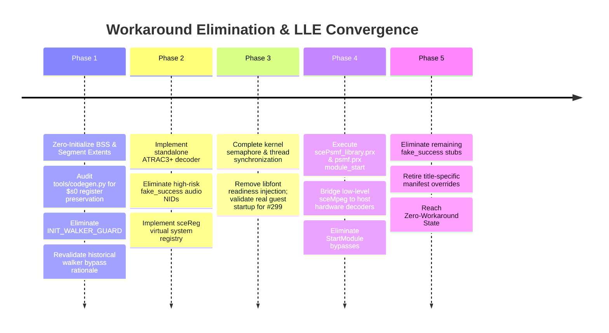

# HLE and Workaround Inventory: System Classification & Migration Plan

## 1. The HLE Budget Doctrine

In accordance with the authentic guest execution doctrine, Nakagawa Recomp tracks and budgets all emulation components across five distinct tiers:

| Tier | Classification | Description | Architectural Objective |
| :--- | :--- | :--- | :--- |
| **Tier 1** | `ORIGINAL_GUEST_EXECUTION` | Compiled MIPS machine code from retail executables and vendor PRX modules executing directly via AOT C chunks or fail-closed interpreter. | **MAXIMIZE** (Target: $\ge 90\%$ of all executed instructions) |
| **Tier 2** | `LLE_RUNTIME` | Low-level hardware virtualization services: register state preservation, MIPS ABI compliance, dynamic dispatch latching, and CPU exception/memory mapping. | **EXPAND & HARDEN** |
| **Tier 3** | `GENERIC_HLE` | Platform OS/kernel abstractions that inherently bridge to the host: thread scheduling, synchronization primitives, Vulkan GE command submission, audio streams, and raw block I/O. | **MAINTAIN STRICTLY GENERIC** |
| **Tier 4** | `TITLE_SPECIFIC_HLE` | Functions or hooks that special-case a specific game title, write hardcoded flags to guest memory, or short-circuit guest execution loops. | **ELIMINATE $\to 0$** |
| **Tier 5** | `PATCH/WORKAROUND` | Fake-success stubs (returning 0 without implementing semantics), loop iteration caps, register clobber guards, and bypasses. | **ELIMINATE $\to 0$** |

### The Cardinal Rule of Lower Layers

For every existing or proposed HLE routine, developers and agents must answer:
> **"Why can this behavior not instead be implemented one layer lower?"**

---

## 2. Quantitative Census of the Current Codebase

HLE registration classes and semantic statuses below are generated by
`python tools/hle_manifest.py --census-markdown build/hle_census.md --census-heading-level 3`;
paste that file between the generated-block markers to regenerate this section; `tools.test_hle_manifest.CensusTests.test_documented_hle_census_matches_generated_source`
fails if its counts or detail rows become stale. `python tools/hle_manifest.py --census-json build/hle_census.json`
(`--census-json` is an alias of `--census`) is the same census as a machine artifact,
and it is the only current source for these counts — including the dedicated-but-unreviewed,
fake-success, controlled-unsupported, partial and compatibility rows. Nothing else in
the tree may hand-write them: `tools/lint_docs.py` rejects a hand-written census count
on a CURRENT page outside this generated block, so a prose figure is either generated
or labelled historical/capture-time. The evidence-tier view
(`HOST_TESTED`, `HARDWARE_MEASURED`, and related tiers) remains available from
`tools/hle_manifest.py --evidence-chain` as a separate evidence dimension.

The public profile-zero guest may not import a dedicated `unreviewed` handler silently
([#341](https://github.com/Jstar269/nakagawa-recomp/issues/341)). The hosted
`profile_zero_fixture` job runs
`python3 tools/hle_manifest.py --imports fixtures/profile_zero/prebuilt/profile_zero_guest.prx --check-profile-zero-imports`
on the digest-checked guest. It fails when an imported NID routes to an `unreviewed`
handler that `PROFILE_ZERO_UNREVIEWED_IMPORTS` in `tools/hle_registry_meta.py` does not
list, and when an entry there is no longer imported or no longer `unreviewed`. That list
names #341 on every entry and only shrinks: reviewing a handler retires its entries.

<!-- BEGIN GENERATED HLE STATUS CENSUS -->
### HLE Semantic Status Census

Registered NIDs: **640** (dedicated **533**, fake_success **4**, controlled_unsupported **103**).
Semantic handler census: **512** handlers across **25** API families, covering **539** handler-associated NID registrations.

| Semantic Status | Handlers | NID Registrations |
| :--- | :---: | :---: |
| `complete` | 13 | 22 |
| `partial` | 172 | 174 |
| `compatibility` | 1 | 1 |
| `controlled_unsupported` | 2 | 6 |
| `unreviewed` | 324 | 336 |

| API Family | Complete | Partial | Compatibility | Controlled Unsupported | Unreviewed | Total Handlers | NID Registrations |
| :--- | :---: | :---: | :---: | :---: | :---: | :---: | :---: |
| `newlib` | 0 | 0 | 0 | 0 | 1 | 1 | 1 |
| `other` | 1 | 0 | 0 | 0 | 0 | 1 | 1 |
| `sceAtrac` | 0 | 0 | 0 | 0 | 32 | 32 | 33 |
| `sceAudio` | 0 | 11 | 0 | 0 | 5 | 16 | 17 |
| `sceCtrl` | 0 | 5 | 0 | 0 | 7 | 12 | 12 |
| `sceDisplay` | 1 | 3 | 0 | 0 | 10 | 14 | 14 |
| `sceDmac` | 0 | 2 | 0 | 0 | 0 | 2 | 2 |
| `sceFont` | 0 | 0 | 0 | 0 | 9 | 9 | 9 |
| `sceGe` | 2 | 6 | 0 | 0 | 6 | 14 | 14 |
| `sceHprm` | 0 | 0 | 0 | 0 | 3 | 3 | 3 |
| `sceImpose` | 0 | 0 | 0 | 0 | 2 | 2 | 2 |
| `sceIo` | 2 | 25 | 0 | 0 | 5 | 32 | 32 |
| `sceKernel` | 3 | 79 | 0 | 0 | 102 | 184 | 202 |
| `sceMp3` | 0 | 0 | 0 | 0 | 20 | 20 | 20 |
| `sceMpeg` | 0 | 8 | 0 | 1 | 27 | 36 | 36 |
| `sceNp` | 0 | 2 | 0 | 0 | 0 | 2 | 2 |
| `sceOpen` | 0 | 0 | 0 | 0 | 1 | 1 | 1 |
| `scePower` | 0 | 6 | 0 | 0 | 12 | 18 | 20 |
| `scePsmf` | 0 | 3 | 0 | 0 | 14 | 17 | 17 |
| `sceReg` | 0 | 15 | 0 | 0 | 0 | 15 | 15 |
| `sceRtc` | 4 | 5 | 0 | 0 | 0 | 9 | 9 |
| `sceSas` | 0 | 0 | 0 | 1 | 27 | 28 | 32 |
| `sceUmd` | 0 | 2 | 1 | 0 | 10 | 13 | 13 |
| `sceUtility` | 0 | 0 | 0 | 0 | 29 | 29 | 29 |
| `sceWlan` | 0 | 0 | 0 | 0 | 2 | 2 | 3 |
| **Total** | **13** | **172** | **1** | **2** | **324** | **512** | **539** |

#### Complete Handlers (Evidence-Backed)

- **`h_Strlen`** (`other`): `strlen` (0x52df196c)
  - Evidence: src/rt/hle_thread_selftest.c:test_sysclib_memory_imports
  - Evidence: src/rt/hle.c:h_Strlen
  - Evidence: public C library contract (strlen)
- **`h_DisplayGetFramePerSec`** (`sceDisplay`): `sceDisplayGetFramePerSec` (0xdba6c4c4)
  - Evidence: src/rt/hle_thread_selftest.c:test_display_frame_per_sec_float_return
  - Evidence: tools/test_hle_manifest.py:FindingRuleTests.test_float_return_metadata_is_live_and_dedicated
  - Evidence: hardware oracle / issue #80 display-clock measurement (59.9400599f in $f0)
- **`h_GeEdramGetAddr`** (`sceGe`): `sceGeEdramGetAddr` (0xe47e40e4)
  - Evidence: tools/psp_oracle/manifest.json:PSP-HLE-GE-EDRAM-001
  - Evidence: fixtures/psp_oracle/probe_hle_measure.c:hle_run
  - Evidence: src/rt/hle.c:h_GeEdramGetAddr
  - Evidence: PSP-HLE-GE-EDRAM-001 cell: edram-addr = 0x04000000
- **`h_GeEdramGetSize`** (`sceGe`): `sceGeEdramGetSize` (0x1f6752ad)
  - Evidence: tools/psp_oracle/manifest.json:PSP-HLE-GE-EDRAM-001
  - Evidence: fixtures/psp_oracle/probe_hle_measure.c:hle_run
  - Evidence: src/rt/hle.c:h_GeEdramGetSize
  - Evidence: PSP-HLE-GE-EDRAM-001 cell: edram-size = 0x00200000
- **`h_IoMkdir`** (`sceIo`): `sceIoMkdir` (0x06a70004)
  - Evidence: src/rt/hle_thread_selftest.c:test_ms0_unified_namespace
  - Evidence: src/rt/hle.c:h_IoMkdir
- **`h_IoRemove`** (`sceIo`): `sceIoRemove` (0xf27a9c51)
  - Evidence: src/rt/hle_thread_selftest.c:test_ms0_unified_namespace
  - Evidence: src/rt/hle.c:h_IoRemove
- **`h_CpuIsIntrEnable`** (`sceKernel`): `sceKernelIsCpuIntrEnable` (0xb55249d2)
  - Evidence: src/rt/hle_thread_selftest.c:test_interrupt_nid_semantics
- **`h_Memset`** (`sceKernel`): `memset` (0x10f3bb61), `sceKernelMemset` (0xa089eca4)
  - Evidence: src/rt/hle_thread_selftest.c:test_sysclib_memory_imports
  - Evidence: src/rt/hle.c:h_Memset
  - Evidence: public C library contract (memset)
- **`h_SetCompiledSdkVersion`** (`sceKernel`): `sceKernelSetCompiledSdkVersion603_605` (0x1b4217bc), `sceKernelSetCompiledSdkVersion380_390` (0x315ad3a0), `sceKernelSetCompiledSdkVersion370` (0x342061e5), `sceKernelSetCompiledSdkVersion600_602` (0x35669d4c), `sceKernelSetCompiledSdkVersion606` (0x358ca1bb), `sceKernelSetCompiledSdkVersion` (0x7591c7db), `sceKernelSetCompiledSdkVersion500_505` (0x91de343c), `sceKernelSetCompiledSdkVersion395` (0xebd5c3e6), `sceKernelSetCompilerVersion` (0xf77d77cb)
  - Evidence: src/rt/sdkver_selftest.c
  - Evidence: tools/test_sdkver_c.py
  - Evidence: public ABI (PSPSDK sdkver.h: sceKernelSetCompiledSdkVersion)
- **`h_RtcGetCurrentClock`** (`sceRtc`): `sceRtcGetCurrentClock` (0x4cfa57b0)
  - Evidence: src/rt/hle_thread_selftest.c:test_time_domains_are_coherent
  - Evidence: src/rt/hle_thread_selftest.c:test_rtc_pointer_validation_and_measured_conversions
  - Evidence: src/rt/hle.c:h_RtcGetCurrentClock
  - Evidence: public PSPSDK contract (psprtc.h: sceRtcGetCurrentClock, tz is minutes from UTC)
  - Evidence: PSPAutotests tests/rtc/rtc.expected (0/+13/+60/-60/-600000/INT_MAX/-INT_MAX all return 0; -60 is one hour before the UTC baseline)
- **`h_RtcGetCurrentTick`** (`sceRtc`): `sceRtcGetCurrentTick` (0x3f7ad767)
  - Evidence: src/rt/hle_thread_selftest.c:test_time_domains_are_coherent
  - Evidence: src/rt/hle_thread_selftest.c:test_rtc_pointer_validation_and_measured_conversions
  - Evidence: src/rt/hle.c:h_RtcGetCurrentTick
  - Evidence: public PSPSDK contract (psprtc.h: sceRtcGetCurrentTick, 0 on success, <0 on error)
  - Evidence: PSPAutotests tests/rtc/rtc.expected (tick advances across a 2 ms delay)
- **`h_RtcGetTick`** (`sceRtc`): `sceRtcGetTick` (0x6ff40acc)
  - Evidence: src/rt/hle_thread_selftest.c:test_rtc_conversion_errors_and_full_range
  - Evidence: src/rt/hle_thread_selftest.c:test_rtc_pointer_validation_and_measured_conversions
  - Evidence: src/rt/hle.c:h_RtcGetTick
  - Evidence: public PSPSDK contract (psprtc.h: sceRtcGetTick, pspRtcCheckValidErrors component ranges)
  - Evidence: PSPAutotests tests/rtc/convert.expected (year 0/10000 -> 0x800001fe with output untouched; year 10/9998/9999 exact ticks)
- **`h_RtcSetTick`** (`sceRtc`): `sceRtcSetTick` (0x7ed29e40)
  - Evidence: src/rt/hle_thread_selftest.c:test_rtc_conversion_errors_and_full_range
  - Evidence: src/rt/hle_thread_selftest.c:test_rtc_pointer_validation_and_measured_conversions
  - Evidence: src/rt/hle.c:h_RtcSetTick
  - Evidence: public PSPSDK contract (psprtc.h: sceRtcSetTick, 0 on success, <0 on error)
  - Evidence: PSPAutotests tests/rtc/convert.expected (checkSetTick: 835072 -> 0001-01-01, 62135596800000000 -> 1970-01-01)

#### Partial Handlers (Named Limitations)

- **`h_AudioChRelease`** (`sceAudio`): `sceAudioChRelease` (0x6fc46853)
  - Limitation: the cells release channel 0 after the two valid blocking-output calls and query it after release; unreserved, out-of-range, and other channel-state release results are unmeasured (#341)
  - Evidence: tools/psp_oracle/manifest.json:PSP-AUDIO-001
  - Evidence: fixtures/psp_oracle/probe.c:run_audio_query
  - Evidence: PSP-AUDIO-001 cells: audio-ch-release, audio-ch-query-released
- **`h_AudioChReserve`** (`sceAudio`): `sceAudioChReserve` (0x5ec81c55)
  - Limitation: audio-ch-reserve measures a successful reservation of channel 0 for 1024 stereo samples; automatic channel selection, invalid size or format, duplicate reservation, and exhaustion/error precedence are unmeasured (#341)
  - Evidence: tools/psp_oracle/manifest.json:PSP-AUDIO-001
  - Evidence: fixtures/psp_oracle/probe.c:run_audio_query
  - Evidence: PSP-AUDIO-001 cell: audio-ch-reserve
- **`h_AudioOutput2Blocking`** (`sceAudio`): `sceAudioOutput2OutputBlocking` (0x2d53f36e)
  - Limitation: audio-out2-output-blocking measures one valid silent 1024-sample block at maximum volume and makes no acoustic claim; not-reserved, volume, buffer-error and audio_output error-propagation behavior are not covered (the handler discards audio_output's return) (#341)
  - Evidence: tools/psp_oracle/manifest.json:PSP-AUDIO-001
  - Evidence: fixtures/psp_oracle/probe.c:run_audio_query
  - Evidence: PSP-AUDIO-001 cell: audio-out2-output-blocking
- **`h_AudioOutput2Release`** (`sceAudio`): `sceAudioOutput2Release` (0x43196845)
  - Limitation: audio-out2-release measures success after the queue drains; the documented #311 cell measures 0x80268002 while samples remain queued and preserves the reservation; releasing when not reserved is not measured (#341)
  - Evidence: tools/psp_oracle/manifest.json:PSP-AUDIO-001
  - Evidence: fixtures/psp_oracle/probe.c:run_audio_query
  - Evidence: PSP-AUDIO-001 cell: audio-out2-release
  - Evidence: docs/HARDWARE_ORACLE.md
- **`h_AudioOutput2Reserve`** (`sceAudio`): `sceAudioOutput2Reserve` (0x01562ba3)
  - Limitation: audio-out2-reserve measures a valid 1024-sample reservation; duplicate Output2 reservation behavior and invalid size bounds are unmeasured (#341)
  - Evidence: tools/psp_oracle/manifest.json:PSP-AUDIO-001
  - Evidence: fixtures/psp_oracle/probe.c:run_audio_query
  - Evidence: PSP-AUDIO-001 cell: audio-out2-reserve
- **`h_AudioOutput2Rest`** (`sceAudio`): `sceAudioOutput2GetRestSample` (0x647cef33)
  - Limitation: the cells query rest samples on one valid 1024-sample Output2 reservation before and after one blocking output; the not-reserved code and other queue states are unmeasured (#341)
  - Evidence: tools/psp_oracle/manifest.json:PSP-AUDIO-001
  - Evidence: fixtures/psp_oracle/probe.c:run_audio_query
  - Evidence: PSP-AUDIO-001 cells: audio-out2-query-before, audio-out2-query-after
- **`h_AudioOutputBlocking`** (`sceAudio`): `sceAudioOutputBlocking` (0x136caf51)
  - Limitation: the cells exercise two maximum-volume outputs with a valid silent stereo buffer and record timing and rest-length values, not audible output; mono, other volumes, invalid buffers/channels, and error precedence are unmeasured (#341)
  - Evidence: tools/psp_oracle/manifest.json:PSP-AUDIO-001
  - Evidence: fixtures/psp_oracle/probe.c:run_audio_query
  - Evidence: PSP-AUDIO-001 cells: audio-ch-output-blocking-0, audio-ch-output-blocking-1
- **`h_AudioRestLen`** (`sceAudio`): `sceAudioGetChannelRestLength` (0xb011922f)
  - Limitation: the cells query channel 0 before and after blocking output and just after release; invalid-channel error behavior and other queue states are unmeasured (#341)
  - Evidence: tools/psp_oracle/manifest.json:PSP-AUDIO-001
  - Evidence: fixtures/psp_oracle/probe.c:run_audio_query
  - Evidence: PSP-AUDIO-001 cells: audio-ch-query-before, audio-ch-query-after, audio-ch-query-released
- **`h_AudioSRCChRelease`** (`sceAudio`): `sceAudioSRCChRelease` (0x5c37c0ae)
  - Limitation: release after a blocking output (0) and release with nothing reserved (0x80260008) are measured (PSP-HLE-AUDIO-SRC-001); whether a release succeeds while samples are still queued, as the Output2 busy rule does, and releasing a reservation made through the other API (refused here as not reserved) are unmeasured (#339)
- **`h_AudioSRCChReserve`** (`sceAudio`): `sceAudioSRCChReserve` (0x38553111)
  - Limitation: the returns for an unreserved slot, a held slot (0x80268002, including Output2 holding it), sample counts 0 (0x80000104), 65 and 4096 (accepted), 48000 Hz (accepted) and channel counts 1 (0x80000104) and 4 (0x80000003) are measured (PSP-HLE-AUDIO-SRC-001); the upper sample-count bound reuses the Output2 range 17..4111, channel counts other than 1, 2 and 4 take the code measured for 4, and rates other than 44100 and 48000 are refused with that same code and a message, all unmeasured (#339)
- **`h_AudioSRCOutputBlocking`** (`sceAudio`): `sceAudioSRCOutputBlocking` (0xe0727056)
  - Limitation: returns 0x80260008 with nothing reserved and the reserved sample count after a reserve (0x400), both measured (PSP-HLE-AUDIO-SRC-001); the volume bound reuses the Output2 bound and the NULL or unreadable buffer result follows the regular output, both unmeasured; the host mixer runs at 44100 Hz, so a 48000 Hz block passes through a band-limited converter and keeps its source-rate pacing (#339)
- **`h_CtrlGetSamplingCycle`** (`sceCtrl`): `sceCtrlGetSamplingCycle` (0x02baad91)
  - Limitation: reports the cycle retained by sceCtrlSetSamplingCycle; PSPAutotests leaves the NULL out-pointer call out as crashing a PSP, so the ILLEGAL_ADDR refusal used here instead is the runtime's fail-closed choice, not a measured code
  - Evidence: src/rt/hle_thread_selftest.c:test_ctrl_sampling_mode_cycle_matrix
  - Evidence: PSPAutotests tests/ctrl/sampling (power-on cycle 0, set/get round trip)
- **`h_CtrlGetSamplingMode`** (`sceCtrl`): `sceCtrlGetSamplingMode` (0xda6b76a1)
  - Limitation: reports the mode retained by sceCtrlSetSamplingMode but does not change the sampled SceCtrlData; the invalid-pointer error code (ILLEGAL_ADDR) is not hardware measured
- **`h_CtrlPeekLatch`** (`sceCtrl`): `sceCtrlPeekLatch` (0xb1d0e5cd)
  - Limitation: the transition and return words are the sceCtrlReadLatch model, source-tested; the non-clearing peek is the project's model and is not hardware measured, because PSP-HLE-CTRL-LATCH-001 cannot tell clearing from keeping (its release field stays saturated with no input)
  - Evidence: src/rt/hle_thread_selftest.c:test_ctrl_peek_latch_keeps_the_latch
  - Evidence: hardware oracle 2026-10-15 PSP-HLE-CTRL-LATCH-001 cases latch-peek-initial and latch-peek-after-poll (no input gives make break press 0 and release 0xFFFFFFFF)
- **`h_CtrlSetSamplingCycle`** (`sceCtrl`): `sceCtrlSetSamplingCycle` (0x6a2774f3)
  - Limitation: validates and stores the cycle, but samples are still latched once per VBLANK whatever the cycle (#1390)
  - Evidence: src/rt/hle_thread_selftest.c:test_ctrl_sampling_mode_cycle_matrix
  - Evidence: PSPAutotests tests/ctrl/sampling2 (0 and 5555..20000 accepted, other cycles refused with 0x800001FE, cycle kept)
- **`h_CtrlSetSamplingMode`** (`sceCtrl`): `sceCtrlSetSamplingMode` (0x1f4011e6)
  - Limitation: validates and stores the mode, but digital mode does not yet centre the sampled analog axes (#1390); whether firmware truncates the argument to 8 bits before the range check is not measured
  - Evidence: src/rt/hle_thread_selftest.c:test_ctrl_sampling_mode_cycle_matrix
  - Evidence: PSPAutotests tests/ctrl/sampling (modes 2 and -1 refused with 0x80000107, mode kept)
- **`h_DisplaySetFrameBuf`** (`sceDisplay`): `sceDisplaySetFrameBuf` (0x289d82fe)
  - Limitation: display-smoke covers only a sync=1 8888 flip with stride 512; other format, address, stride, and error-precedence cases remain outside this route (#341)
  - Evidence: Makefile:display-smoke-run
  - Evidence: fixtures/display_smoke/generate.py:verify
  - Evidence: fixtures/display_smoke/generate.py:run
- **`h_DisplayWaitVblankStart`** (`sceDisplay`): `sceDisplayWaitVblankStart` (0x984c27e7)
  - Limitation: display-smoke covers ordinary guest-thread waits; interrupt-context behavior and callback wait variants remain outside this route (#341)
  - Evidence: Makefile:display-smoke-run
  - Evidence: fixtures/display_smoke/generate.py:run
  - Evidence: tools/test_sched_invariants.py:test_the_two_display_nids_have_separate_handlers
- **`h_DisplayWaitVblankStartMulti`** (`sceDisplay`): `sceDisplayWaitVblankStartMulti` (0x40f1469c)
  - Limitation: waits the requested positive count of scheduler VBLANK periods; zero count returns SCE_KERNEL_ERROR_INVALID_VALUE (0x800001fe) before the wait-context check, following the historical waits-matrix transcription; callback behavior and hardware timing are not measured
- **`h_DmacMemcpy`** (`sceDmac`): `sceDmacMemcpy` (0x617f3fe6)
  - Limitation: active-transfer guest-time duration unmeasured (ordering-only window) and invalid truncated-tail validation precedence unmodeled (#303, #341)
- **`h_DmacTryMemcpy`** (`sceDmac`): `sceDmacTryMemcpy` (0xd97f94d8)
  - Limitation: active-transfer guest-time duration unmeasured (ordering-only window) and invalid truncated-tail validation precedence unmodeled (#303, #341)
- **`h_GeBreak`** (`sceGe`): `sceGeBreak` (0xb448ec0d)
  - Limitation: models synchronous display list pause (mode 0) and queue reset (mode 1); argument and parameter buffer inspection are K1/read checked only, asynchronous hardware command boundary timing remains unmodeled (#341); PSP-measured in the eligible PSP-GE-CONTROL-001 2026-10-15 re-run: the 0x80000020 no-active-list result, the invalid-mode result 0x80000107 (mode -1 only), the mode 0 queue id and the paused sync statuses (4, 2) for a list broken mid-draw, the mode 1 result 0 with one list stalled at its start, and the 0x80000100 sync result for a list the reset removed; a list enqueued with no stall address completes inside sceGeListEnQueue, so the runtime cannot reproduce the mid-draw break and returns 0x80000020 with sync peeks of 0 on that sequence; breaking a stalled list, a mode 1 reset of a paused list and modes above 1 are unmeasured and follow the same codes
  - Evidence: src/rt/hle_thread_selftest.c:test_ge_break_continue
- **`h_GeContinue`** (`sceGe`): `sceGeContinue` (0x4c06e472)
  - Limitation: resumes a paused display list using the synchronous GE runner; hardware timing and multi-queue priority ordering remain unmodeled (#341); the 0 result when no list is paused is PSP-measured (PSP-GE-CONTROL-001, eligible 2026-10-15 re-run)
  - Evidence: src/rt/hle_thread_selftest.c:test_ge_break_continue
- **`h_GeEdramSetAddrTranslation`** (`sceGe`): `sceGeEdramSetAddrTranslation` (0xb77905ea)
  - Limitation: replacement-width returns and restoration to boot width 1024 are measured; width 0 as an input, unsupported-width error 0x80000107 (a project choice), and applying the setting to actual GE address translation are not measured
  - Evidence: docs/HARDWARE_ORACLE.md (PSP-HLE-GE-EDRAM-001: initial width, 512/1024/2048/4096 replacements, restore and final query)
- **`h_GeListDeQueue`** (`sceGe`): `sceGeListDeQueue` (0x5fb86ab0)
  - Limitation: a stalled list returns BUSY (0x80000021) and stays queued, PSP-measured (PSP-GE-CONTROL-001, eligible 2026-10-15 re-run); paused, completed, cancelled and unknown queue ids are refused as NOT_IMPLEMENTED because no dequeue result is measured for them (#341)
  - Evidence: src/rt/hle_thread_selftest.c:test_ge_break_continue
- **`h_GeListEnQueue`** (`sceGe`): `sceGeListEnQueue` (0xab49e76a)
  - Limitation: display-smoke covers one unstalled synchronous list; ring-buffer stall deferral, a full list table (slot 0 is reused), argument and priority validation, and asynchronous execution timing remain outside this route (#341)
  - Evidence: Makefile:display-smoke-run
  - Evidence: fixtures/display_smoke/generate.py:flight_smoke
  - Evidence: src/rt/hle_thread_selftest.c:test_flight_recorder_ge_present_events
- **`h_GeListEnQueueHead`** (`sceGe`): `sceGeListEnQueueHead` (0x1c0d95a6)
  - Limitation: idle-list execution follows the shared enqueue path; head ordering is refused while a list is stalled, and asynchronous queue behavior remains unmodeled
- **`h_IoChangeAsyncPriority`** (`sceIo`): `sceIoChangeAsyncPriority` (0xb293727f)
  - Limitation: priority selects queued host requests, but PSP priority ordering and its interaction with callbacks are not hardware-measured
  - Evidence: src/rt/hle_thread_selftest.c:test_io_async_and_path_imports
- **`h_IoChdir`** (`sceIo`): `sceIoChdir` (0x55f4717d)
  - Limitation: the modeled current directory is per-thread and resolves contained Memory Stick paths; PSP behavior for other devices is not established
  - Evidence: src/rt/hle_thread_selftest.c:test_io_async_and_path_imports
- **`h_IoChstat`** (`sceIo`): `sceIoChstat` (0xb8a740f4)
  - Limitation: only the mode field is supported; attribute, size, and timestamp fields fail closed with IO_CHSTAT_NON_MODE_FIELDS
  - Evidence: src/rt/hle_thread_selftest.c:test_io_async_and_path_imports
- **`h_IoClose`** (`sceIo`): `sceIoClose` (0x810c4bc3)
  - Limitation: the measured cells establish close result 0 for one freshly written host0 file and for the eleven successful fixed UMD/disc/msstor0p1 opens; double close, directory descriptors, standard descriptors and error precedence are not hardware measured, and the refusal while an asynchronous request is pending (ASYNC_BUSY) is covered by the host selftest only (#341)
  - Evidence: docs/HARDWARE_ORACLE.md (PSP-IO-001: io-write)
  - Evidence: docs/HARDWARE_ORACLE.md (PSP-UMDIO-001: io-open-0000..0012)
  - Evidence: src/rt/hle_thread_selftest.c:test_umd_io_console_model
  - Evidence: src/rt/hle_thread_selftest.c:test_io_async_and_path_imports
- **`h_IoCloseAsync`** (`sceIo`): `sceIoCloseAsync` (0xff5940b6)
  - Limitation: request completion uses a deterministic synthetic import-boundary scheduler; close callback timing remains unmeasured
  - Evidence: src/rt/hle_thread_selftest.c:test_fd_namespace
- **`h_IoDclose`** (`sceIo`): `sceIoDclose` (0xeb092469)
  - Limitation: the measured cells establish close result 0 for the two successful disc0:/ and disc0:/PSP_GAME directory descriptors only; closing a file, stale or out-of-range descriptor, and listings that were read before the close remain host-selftested only (#341)
  - Evidence: docs/HARDWARE_ORACLE.md (PSP-UMDIO-001: io-dopen-0004 and io-dopen-0005 close results)
  - Evidence: src/rt/hle_thread_selftest.c:test_umd_io_console_model
- **`h_IoDevctl`** (`sceIo`): `sceIoDevctl` (0x54f5fb11)
  - Limitation: Memory Stick insert/eject callbacks are notified once, with argument 1, when registered; no later insert or eject event exists, and the 32-entry bound, duplicate entries and 0x80010016 refusals follow PPSSPP's model, not a hardware measurement (#1378)
- **`h_IoDopen`** (`sceIo`): `sceIoDopen` (0xb29ddf9c)
  - Limitation: the measured cells establish results and close outcomes for six fixed UMD/disc path calls only; directory contents/order, MS0 paths and general error precedence remain unmeasured (#341)
  - Evidence: src/rt/hle_thread_selftest.c:test_umd_io_console_model
  - Evidence: docs/HARDWARE_ORACLE.md (PSP-UMDIO-001: io-dopen-0000..0005)
- **`h_IoGetAsyncStat`** (`sceIo`): `sceIoGetAsyncStat` (0xcb05f8d6)
  - Limitation: the pending interval is a deterministic synthetic import-boundary policy, not PSP-measured timing
  - Evidence: src/rt/hle_thread_selftest.c:test_io_async_and_path_imports
- **`h_IoIoctlAsync`** (`sceIo`): `sceIoIoctlAsync` (0xe95a012b)
  - Limitation: request completion uses a deterministic synthetic import-boundary scheduler; PSP ioctl timing and callback ordering remain unmeasured
  - Evidence: src/rt/hle_thread_selftest.c:test_io_async_and_path_imports
- **`h_IoLseek`** (`sceIo`): `sceIoLseek` (0x27eb27b8)
  - Limitation: PSP-IO-001 measures 64-bit SEEK_SET 32, SEEK_CUR -16, SEEK_END 0 and the end position after a 32-byte append on one host0 file; on a file, a destination before the start or past the end fails closed with IO_LSEEK_OUT_OF_RANGE (#1380); large offsets, invalid whence and error precedence remain unmeasured (#341). UMD block-device seeks follow PSP-UMDRAW-001's captured but not acceptance-qualified cells (sector positions, SEEK_END at the last sector, 0x8001b003 for a negative or far-past-the-disc position); the refusal edge between the last sector and the captured far position is inferred
  - Evidence: docs/HARDWARE_ORACLE.md (PSP-IO-001: io-lseek and io-append)
  - Evidence: src/rt/hle_thread_selftest.c:test_umd_block_device_sectors
- **`h_IoLseek32Async`** (`sceIo`): `sceIoLseek32Async` (0x1b385d8f)
  - Limitation: request completion uses a deterministic synthetic import-boundary scheduler; PSP timing and callback ordering remain unmeasured
  - Evidence: src/rt/hle_thread_selftest.c:test_io_async_and_path_imports
- **`h_IoLseekAsync`** (`sceIo`): `sceIoLseekAsync` (0x71b19e77)
  - Limitation: request completion uses a deterministic synthetic import-boundary scheduler; 64-bit seek timing and callback ordering are not hardware-measured
  - Evidence: src/rt/hle_thread_selftest.c:test_io_async_and_path_imports
- **`h_IoOpen`** (`sceIo`): `sceIoOpen` (0x109f50bc)
  - Limitation: measured coverage is one host0 file's create/write/read/append/missing-file path plus PSP-UMDIO-001's fixed open paths and flags; an open without PSP_O_CREAT never creates a file, and PSP_O_CREAT|PSP_O_EXCL on an existing file fails closed with IO_OPEN_EXCL_EXISTING (#1380); other flag combinations and general error precedence remain unmeasured (#341). UMD block-device reads and seeks are covered under sceIoRead and sceIoLseek
  - Evidence: docs/HARDWARE_ORACLE.md (PSP-IO-001: io-open-create, io-write, io-read-verify, io-append, io-errors)
  - Evidence: docs/HARDWARE_ORACLE.md (PSP-UMDIO-001: io-open-0000..0012)
  - Evidence: src/rt/hle_thread_selftest.c:test_ms0_unified_namespace
- **`h_IoOpenAsync`** (`sceIo`): `sceIoOpenAsync` (0x89aa9906)
  - Limitation: open runs its host lookup at submission to return the PSP-visible fd, then completes as a pending request on the import-boundary service and notifies the fd's async callback; async timing and callback ordering are synthetic, not hardware-measured, and a failed open returns its error directly instead of an fd carrying it
  - Evidence: src/rt/hle_thread_selftest.c:test_fd_namespace
  - Evidence: src/rt/hle_thread_selftest.c:test_io_open_async_notifies_later_callback
- **`h_IoPollAsync`** (`sceIo`): `sceIoPollAsync` (0x3251ea56)
  - Limitation: the pending interval is a deterministic synthetic import-boundary policy, not PSP-measured timing
  - Evidence: src/rt/hle_thread_selftest.c:test_io_async_and_path_imports
- **`h_IoRead`** (`sceIo`): `sceIoRead` (0x6a638d83)
  - Limitation: PSP-IO-001 measures one 64-byte host0 read that returns 64 matching bytes, and that reading descriptor -1 returns a negative result (the exact code is not recorded in public evidence); short reads at end of file, zero-length file reads, partial-read position advance, unreadable buffers, write-only descriptors and standard-stream reads remain unmeasured (#341). UMD block-device reads follow PSP-UMDRAW-001's captured but not acceptance-qualified cells (counts and results in 2048-byte sectors, the position advancing by the count, 0x80010016 for a zero count); a read crossing the last sector stays at the raw-device boundary, and the runtime refuses a destination outside guest memory where the console overran the buffer
  - Evidence: docs/HARDWARE_ORACLE.md (PSP-IO-001: io-read-verify and io-errors)
  - Evidence: src/rt/hle_thread_selftest.c:test_ms0_unified_namespace
  - Evidence: src/rt/hle_thread_selftest.c:test_umd_block_device_sectors
- **`h_IoReadAsync`** (`sceIo`): `sceIoReadAsync` (0xa0b5a7c2)
  - Limitation: request completion uses a deterministic synthetic import-boundary scheduler; PSP timing and callback ordering remain unmeasured
  - Evidence: src/rt/hle_thread_selftest.c:test_io_async_and_path_imports
- **`h_IoRmdir`** (`sceIo`): `sceIoRmdir` (0x1117c65f)
  - Limitation: empty-directory removal and nonempty refusal are tested with synthetic roots; PSP error precedence beyond those cases remains unmeasured
  - Evidence: src/rt/hle_thread_selftest.c:test_io_async_and_path_imports
- **`h_IoSetAsyncCallback`** (`sceIo`): `sceIoSetAsyncCallback` (0xa12a0514)
  - Limitation: completion queues the modeled thread callback; PSP callback argument and interleaving behavior remain unmeasured
  - Evidence: src/rt/hle_thread_selftest.c:test_io_async_and_path_imports
- **`h_IoSync`** (`sceIo`): `sceIoSync` (0xab96437f)
  - Limitation: Memory Stick handles are flushed and synced; other devices and nonzero unknown arguments fail closed with IO_SYNC_DEVICE or IO_SYNC_ARGUMENT
  - Evidence: src/rt/hle_thread_selftest.c:test_io_async_and_path_imports
- **`h_IoWaitAsync`** (`sceIo`): `sceIoWaitAsync` (0xe23eec33)
  - Limitation: the host operation runs when the guest waits; PSP blocking, wake, and callback interleaving remain unmeasured
  - Evidence: src/rt/hle_thread_selftest.c:test_io_async_and_path_imports
- **`h_IoWaitAsyncCB`** (`sceIo`): `sceIoWaitAsyncCB` (0x35dbd746)
  - Limitation: callback dispatch is modeled at the wait boundary; PSP blocking and callback interleaving remain unmeasured
- **`h_IoWrite`** (`sceIo`): `sceIoWrite` (0x42ec03ac)
  - Limitation: PSP-IO-001 measures a 64-byte write that returns 64 on a created host0 file and a 32-byte write through an append-mode descriptor that returns 32; read-only descriptors, short writes, zero-length writes, unreadable source buffers, raw devices and standard-stream writes remain unmeasured (#341)
  - Evidence: docs/HARDWARE_ORACLE.md (PSP-IO-001: io-write and io-append)
  - Evidence: src/rt/hle_thread_selftest.c:test_ms0_unified_namespace
- **`h_IoWriteAsync`** (`sceIo`): `sceIoWriteAsync` (0x0facab19)
  - Limitation: request completion uses a deterministic synthetic import-boundary scheduler; PSP timing and callback ordering remain unmeasured
  - Evidence: src/rt/hle_thread_selftest.c:test_io_async_and_path_imports
- **`h_AllocMemoryBlock`** (`sceKernel`): `sceKernelAllocMemoryBlock` (0xfe707fdf)
  - Limitation: models main-user-partition Low placement with the four-byte options header; valid High, Addr, LowAligned, HighAligned, and extended-options forms are refused, and allocation fragmentation/error precedence are not hardware measured
- **`h_AllocateFpl`** (`sceKernel`): `sceKernelAllocateFpl` (0xd979e9bf)
  - Limitation: ordinary allocation, one finite timeout, one-waiter hand-off, delete wake, and measured block/status layout are covered; invalid output pointers, negative timeout handling, and multiple-waiter ordering are not measured
  - Evidence: docs/HARDWARE_ORACLE.md (Kernel-object semantics, PSP-B1-01 and PSP-B2-01 FPL cells)
  - Evidence: docs/HARDWARE_ORACLE.md (PSP-HLE-KERNEL-STATUS-001 FPL create, exhaustion, status, free and delete cells)
- **`h_AllocateVpl`** (`sceKernel`): `sceKernelAllocateVpl` (0xbed27435)
  - Limitation: ordinary allocation, one finite timeout, measured pool accounting, and one-waiter hand-off are covered; invalid output pointers, invalid sizes, and fragmented-pool behavior beyond the measured cases are not measured
  - Evidence: docs/HARDWARE_ORACLE.md (Kernel-object semantics, PSP-B1-01 and PSP-B2-01 VPL cells)
- **`h_CancelAlarm`** (`sceKernel`): `sceKernelCancelAlarm` (0x7e65b999)
  - Limitation: an unknown, cancelled or already-finished alarm UID returns the hardware-measured unknown-alarm code; treating a one-shot that has already fired as unknown (its UID is released when the handler returns 0) is the project's model and is not separately measured
  - Evidence: src/rt/hle_thread_selftest.c:test_alarm_registration_and_error_codes
  - Evidence: src/rt/hle_thread_selftest.c:test_alarm_cancel_before_firing_prevents_the_handler
  - Evidence: src/rt/sched_selftest.c:test_alarm_cancel_and_ordering
- **`h_CancelEventFlag`** (`sceKernel`): `sceKernelCancelEventFlag` (0xcd203292)
  - Limitation: the cited cell measures a blocked waiter's WAIT_CANCEL outcome after event cancellation; it does not establish the cancel call's return, pattern assignment, waiter-count output, unknown-ID behavior, pointer errors, or multiple-waiter ordering
  - Evidence: docs/HARDWARE_ORACLE.md (PSP-WAIT-001: event-cancel-before-deadline-late-dispatch returns WAIT_CANCEL to the waiter)
- **`h_CancelMsgPipe`** (`sceKernel`): `sceKernelCancelMsgPipe` (0x349b864d)
  - Limitation: releases every active send and receive waiter with WAIT_CANCEL, writes both waiter counts and each timed waiter's remaining timeout and empties the buffer; a waiter paused inside a callback, the unknown-UID code and error precedence are not hardware measured (#1381)
  - Evidence: PSPAutotests tests/threads/msgpipe (cancel case: waiters released with WAIT_CANCEL, counts and remaining timeout written)
  - Evidence: src/rt/hle_thread_selftest.c:test_msgpipe_cancel_and_refer
- **`h_CancelReceiveMbx`** (`sceKernel`): `sceKernelCancelReceiveMbx` (0x87d4dd36)
  - Limitation: cancel with zero waiters and invalid numWait-thread pointer error class unmeasured (#339, #341)
- **`h_CancelSema`** (`sceKernel`): `sceKernelCancelSema` (0x8ffdf9a2)
  - Limitation: the cited cells establish the -1 reset and a blocked waiter's WAIT_CANCEL outcome; other replacement counts, over-max refusal, optional waiter-count output, unknown IDs, pointer errors, and multiple-waiter ordering are not established by those citations
  - Evidence: docs/HARDWARE_ORACLE.md (PSP-B2-01: CancelSema(-1) restores the create-time initial count)
  - Evidence: docs/HARDWARE_ORACLE.md (PSP-WAIT-001: sema-cancel-before-deadline-late-dispatch returns WAIT_CANCEL to the waiter)
- **`h_ClearEventFlag`** (`sceKernel`): `sceKernelClearEventFlag` (0x812346e4)
  - Limitation: the measured mask behavior matches the normal-object path; an unknown UID, or a UID of another kernel-object kind, returns the measured unknown-event-flag code 0x8002019A; error precedence is not covered
  - Evidence: docs/HARDWARE_ORACLE.md (PSP-B1-01: ClearEventFlag(mask) keeps only the bits in mask)
- **`h_CreateFpl`** (`sceKernel`): `sceKernelCreateFpl` (0xc07bb470)
  - Limitation: the cited cells cover valid pool creation and block/status behavior; the handler converts zero block size/count to 16/1, a branch not established by those cited valid-pool cells, and allocation exhaustion plus partition, attribute, and option error precedence need separate evidence
  - Evidence: docs/HARDWARE_ORACLE.md (PSP-HLE-KERNEL-STATUS-001: fpl-create and valid pool status/allocation cells)
  - Evidence: docs/HARDWARE_ORACLE.md (Kernel-object semantics: FPL blocks are blockSize apart)
- **`h_CreateLwMutex`** (`sceKernel`): `sceKernelCreateLwMutex` (0x19cff145)
  - Limitation: the cells cover recursive and non-recursive initialization, workarea fields, and one waiter hand-off; invalid workareas, unsupported attribute bits, negative counts, option data, and multi-waiter ordering are not established
  - Evidence: docs/HARDWARE_ORACLE.md (PSP-B1-01 and PSP-B2-01: LwMutex creation workarea and one-waiter hand-off)
- **`h_CreateMbx`** (`sceKernel`): `sceKernelCreateMbx` (0x8125221d)
  - Limitation: NULL-name create error and interrupt-context placement unmeasured (#339, #341)
- **`h_CreateMutex`** (`sceKernel`): `sceKernelCreateMutex` (0xb7d098c6)
  - Limitation: the measured cell covers ordinary unlocked and initially-held mutex status; name and attribute validation, recursive edge cases, invalid arguments, and allocation exhaustion are not covered
  - Evidence: docs/HARDWARE_ORACLE.md (PSP-MUTEX-001: mutex-refer-unlocked creation and observed status fields)
- **`h_CreateSema`** (`sceKernel`): `sceKernelCreateSema` (0xd6da4ba1)
  - Limitation: the cited cells cover the measured count and attribute rules plus initial-count retention; name-pointer behavior, object exhaustion, and invalid-argument precedence remain unmeasured
  - Evidence: docs/HARDWARE_ORACLE.md (PSP-B1-01: CreateSema accepts init greater than max and max zero, and rejects invalid attributes)
  - Evidence: docs/HARDWARE_ORACLE.md (PSP-B2-01: CancelSema restores the create-time initial count)
- **`h_CreateVTimer`** (`sceKernel`): `sceKernelCreateVTimer` (0x20fff560)
  - Limitation: the option struct is ignored, as on a PSP (pspautotests vtimers/create.expected at 2ed7c9c5, recorded on a PSP: every declared size creates the same timer), and an unreadable one stops the run by name; 64 creates in a row are measured (PSP-HLE-VTIMER-003), so the table holds 64, while the same PSP-recorded output shows 1024 creates succeed; a NULL name is accepted here, where that output shows 0x80020001; the no-slot code 0x80020190 is unmeasured; the microsecond unit is consistent with PSP-HLE-VTIMER-002, not a precise rate measurement (#325)
- **`h_CreateVpl`** (`sceKernel`): `sceKernelCreateVpl` (0x56c039b5)
  - Limitation: valid pool creation and measured accounting are covered; the handler maps size zero to VPL_EXHAUSTED and ignores the partition argument, but the cited valid-pool cells do not establish those edge results, allocation exhaustion, or option behavior
  - Evidence: docs/HARDWARE_ORACLE.md (PSP-B1-01 and PSP-B2-01: valid VPL creation, accounting, allocation, and deletion)
- **`h_DeleteFpl`** (`sceKernel`): `sceKernelDeleteFpl` (0xed1410e0)
  - Limitation: valid deletion and the delete-wait outcome are covered; an invalid or already-deleted UID currently returns success in the handler, while the cited delete cells use a valid pool, and multi-waiter teardown ordering is not measured
  - Evidence: docs/HARDWARE_ORACLE.md (PSP-HLE-KERNEL-STATUS-001: valid fpl-delete and refer-after-delete cells)
  - Evidence: docs/HARDWARE_ORACLE.md (Kernel-object semantics, PSP-B2-01: deleting an FPL with a waiter)
- **`h_DeleteLwMutex`** (`sceKernel`): `sceKernelDeleteLwMutex` (0x60107536)
  - Limitation: the cited cells cover valid deletion and the measured workarea fields; forged workareas, invalid-address precedence, stale UIDs, and multiple-waiter deletion behavior are not fully covered
  - Evidence: docs/HARDWARE_ORACLE.md (PSP-B1-01: deleting a held LwMutex updates the workarea fields)
- **`h_DeleteMbx`** (`sceKernel`): `sceKernelDeleteMbx` (0x86255ada)
  - Limitation: delete-while-waited is mailbox-measured on 2026-10-15 (PSP-3000, 6.61): the waiter returns WAIT_DELETE and its timeout word is rewritten to the remaining time; interrupt-context placement unmeasured (#339, #341)
- **`h_DeleteSema`** (`sceKernel`): `sceKernelDeleteSema` (0x28b6489c)
  - Limitation: a valid delete with one waiter and the unknown-semaphore code are covered; no-waiter behavior, multiple-waiter ordering, and interrupt-context precedence are not established
  - Evidence: docs/HARDWARE_ORACLE.md (PSP-B1-01 and PSP-B2-01: unknown semaphore ID and deleting a waited-on semaphore)
- **`h_DeleteThread`** (`sceKernel`): `sceKernelDeleteThread` (0x9fa03cd3)
  - Limitation: post-exit delete and restart outcomes are covered for four worker exit statuses; deleting a live or waiting thread, unknown IDs, and multi-joiner cleanup are not established
  - Evidence: docs/HARDWARE_ORACLE.md (PSP-THREAD-EXIT-001: ED-D77, ED-D00, ED-DNEG, and ED-DERR post-exit delete/restart cells)
- **`h_DeleteVTimer`** (`sceKernel`): `sceKernelDeleteVTimer` (0x328f9e52)
  - Limitation: delete of a stopped timer returns 0 (PSP-HLE-VTIMER-002) and a second delete returns 0x800201BE (PSP-HLE-VTIMER-001, -003); interrupt-context placement unmeasured (#325)
- **`h_DeleteVpl`** (`sceKernel`): `sceKernelDeleteVpl` (0x89b3d48c)
  - Limitation: valid deletion with allocated blocks is covered; deletion with blocked waiters, unknown IDs, arbitrary fragmentation, and invalid-free precedence are not established
  - Evidence: docs/HARDWARE_ORACLE.md (PSP-B1-01: valid VPL deletion while blocks are held)
- **`h_ExitDeleteThread`** (`sceKernel`): `sceKernelExitDeleteThread` (0x809ce29b)
  - Limitation: worker ExitDeleteThread status, joiner result, and post-exit UID/delete behavior are covered for four values; main/launcher teardown is not covered by these cells and PSP-TEARDOWN-001 remains captured-only
  - Evidence: docs/HARDWARE_ORACLE.md (PSP-THREAD-EXIT-001: ED-D77, ED-D00, ED-DNEG, and ED-DERR)
- **`h_ExitThread`** (`sceKernel`): `sceKernelExitThread` (0xaa73c935)
  - Limitation: worker ExitThread status and WaitThreadEnd/ReferThreadStatus outcomes are covered for four values; main/launcher teardown, callbacks during exit, and other thread roles are not established
  - Evidence: docs/HARDWARE_ORACLE.md (PSP-THREAD-EXIT-001: ED-X77, ED-X00, ED-XNEG, and ED-XERR)
- **`h_FreeFpl`** (`sceKernel`): `sceKernelFreeFpl` (0xf6414a71)
  - Limitation: valid block frees and resulting free counts are covered; invalid, unaligned, repeated, or foreign-pool frees and waiter ordering are not established by the cited cells
  - Evidence: docs/HARDWARE_ORACLE.md (PSP-HLE-KERNEL-STATUS-001: fpl-free-a, fpl-free-b, and status after free)
- **`h_FreeMemoryBlock`** (`sceKernel`): `sceKernelFreeMemoryBlock` (0x50f61d8a)
  - Limitation: releases UIDs created by the modeled Low allocation path; invalid-UID result is source-tested but not hardware measured
- **`h_FreeVpl`** (`sceKernel`): `sceKernelFreeVpl` (0xb736e9ff)
  - Limitation: valid frees under the measured pool accounting are covered; invalid IDs/addresses, misalignment, arbitrary fragmentation/coalescing, and zero-size allocation behavior are not established
  - Evidence: docs/HARDWARE_ORACLE.md (PSP-B1-01: VPL pool accounting, allocation placement, and free sequence)
- **`h_GetMemoryBlockAddr`** (`sceKernel`): `sceKernelGetMemoryBlockAddr` (0xdb83a952)
  - Limitation: resolves UIDs created by the modeled Low allocation path; output-pointer and unknown-UID results are source-tested but not hardware measured
- **`h_GetSystemTime`** (`sceKernel`): `sceKernelGetSystemTime` (0xdb738f35)
  - Limitation: writes the 64-bit modeled microsecond clock and returns 0; the illegal-address result is the runtime's own code (RTC_ILLEGAL_ADDR), not a PSP measurement, and the clock origin is not compared with hardware
- **`h_GetSystemTimeLow`** (`sceKernel`): `sceKernelGetSystemTimeLow` (0x369ed59d)
  - Limitation: returns the low 32 bits of the modeled microsecond clock, which wraps; the clock origin and wrap timing are not compared with hardware
- **`h_GetSystemTimeWide`** (`sceKernel`): `sceKernelGetSystemTimeWide` (0x82bc5777)
  - Limitation: the two system-clock reads advanced 220,608 around a bounded 20 ms delay, but host0 logging offset the intervals and the VTimer/system-clock deltas agree only within about 8%; this is consistent with the microsecond unit but does not establish a precise rate or absolute system-time values
  - Evidence: docs/HARDWARE_ORACLE.md (PSP-HLE-VTIMER-002: system-clock reads around the bounded delay)
- **`h_GetVTimerBase`** (`sceKernel`): `sceKernelGetVTimerBase` (0xb3a59970)
  - Limitation: returns the same base as ReferVTimerStatus, measured equal while running and 0 once stopped (PSP-HLE-VTIMER-002); the value, guest time at the most recent Start, is consistent with that run's system-clock reads, not measured exactly; NULL out-pointer returns ILLEGAL_ADDR as a runtime safety choice after PSP-3000 hung on ReferSystemStatus(NULL) (PSP-HLE-NULL-OUT-001), not as a measured VTimer result; deleted-UID code is unmeasured and reused by analogy; no game relies on the NULL output (#325)
- **`h_GetVTimerTime`** (`sceKernel`): `sceKernelGetVTimerTime` (0x034a921f)
  - Limitation: deleted-UID code 0x800201BE with the output untouched measured (PSP-HLE-VTIMER-003); time = system time - base and the microsecond unit are consistent with PSP-HLE-VTIMER-002 (deltas within about 8%), not a precise rate measurement; NULL out-pointer returns ILLEGAL_ADDR as a runtime safety choice after PSP-3000 hung on ReferSystemStatus(NULL) (PSP-HLE-NULL-OUT-001), not as a measured VTimer result; no game relies on the output (#325)
- **`h_KernelDevkitVersion`** (`sceKernel`): `sceKernelDevkitVersion` (0x3fc9ae6a)
  - Limitation: returns the 6.61 devkit word for every firmware: only the measured firmware is modelled, and other firmware devkit words are not
  - Evidence: src/rt/hle_thread_selftest.c:test_kernel_devkit_version_measured
  - Evidence: src/rt/sdkver.h:SR_PSP_FIRMWARE_DEVKIT_VERSION
  - Evidence: hardware oracle 2026-10-15 PSP-SYSTEM-001 case model-profile (0x06060110)
- **`h_LockMutex`** (`sceKernel`): `sceKernelLockMutex` (0xb011b11f)
  - Limitation: measured cases cover finite timeout, priority inheritance, and the listed interrupt-context refusals; full attribute/recursion ranges, negative counts, multi-waiter priority ordering, and invalid timeout-pointer precedence are not measured
  - Evidence: docs/HARDWARE_ORACLE.md (PSP-MUTEX-001: mutex-timeout-quanta, mutex-priority-inheritance, and accepted interrupt-context cell)
- **`h_Memcpy`** (`sceKernel`): `sceKernelMemcpy` (0x1839852a)
  - Limitation: copies with memmove semantics for overlapping spans, which the PSP's memcpy does not promise and whose overlap behaviour is unmeasured; bad guest spans are refused through the runtime's out-of-range path, not a PSP error code
- **`h_NotifyCallback`** (`sceKernel`): `sceKernelNotifyCallback` (0xc11ba8c4)
  - Limitation: the cited cell covers notification coalescing in one callback case; callback creation state, invalid UID behavior, dispatch context, and ordering with multiple callbacks are not established
  - Evidence: docs/HARDWARE_ORACLE.md (Kernel-object semantics: two callback notifications coalesce into one handler call with count 2)
- **`h_PollEventFlag`** (`sceKernel`): `sceKernelPollEventFlag` (0x30fd48f0)
  - Limitation: the cited cells cover an unmet poll's outBits and the zero-bit refusal; other wait modes, invalid output pointers, and error precedence are not established
  - Evidence: docs/HARDWARE_ORACLE.md (Kernel-object semantics, PSP-B1-01: unmet poll output and zero-bit refusal)
- **`h_PollMbx`** (`sceKernel`): `sceKernelPollMbx` (0x0d81716a)
  - Limitation: invalid-message-pointer error class unmeasured (#339, #341)
- **`h_ReceiveMbx`** (`sceKernel`): `sceKernelReceiveMbx` (0x18260574)
  - Limitation: delete-while-waited is mailbox-measured on 2026-10-15 (WAIT_DELETE and timeout word rewritten to the remaining time); ILLEGAL_CONTEXT precedence for a blocking receive unmeasured; priority-mailbox circular linking not separately asserted beyond campaign facts (#339, #341)
- **`h_ReceiveMbxCB`** (`sceKernel`): `sceKernelReceiveMbxCB` (0xf3986382)
  - Limitation: callback-dispatch interleaving during a mailbox wait unmeasured; ILLEGAL_CONTEXT precedence unmeasured (#339, #341)
- **`h_ReceiveMsgPipe`** (`sceKernel`): `sceKernelReceiveMsgPipe` (0x74829b76)
  - Limitation: the cited cell covers a blocked receiver served by a sender; empty/short receive result sizes, invalid pointers, timeout precedence, and multiple-receiver ordering are not established
  - Evidence: docs/HARDWARE_ORACLE.md (Kernel-object semantics, PSP-B3-01: blocked receiver is served directly by a sender)
- **`h_ReferEventFlagStatus`** (`sceKernel`): `sceKernelReferEventFlagStatus` (0xa66b0120)
  - Limitation: the cited cells establish bytes written and size-word behavior at four buffer sizes; full field values, unknown UID codes, invalid pointers, and error precedence are not established by that size row
  - Evidence: docs/HARDWARE_ORACLE.md (PSP-KERNEL-STATUS-001: event-size-zero, event-size-8, event-size-40, and event-size-full)
- **`h_ReferFplStatus`** (`sceKernel`): `sceKernelReferFplStatus` (0xd8199e4c)
  - Limitation: valid pool layout and the cited short/zero-size behavior are covered; tick fields, invalid pointers, unknown IDs beyond the after-delete refer, and error precedence are not established
  - Evidence: docs/HARDWARE_ORACLE.md (PSP-HLE-KERNEL-STATUS-001: valid FPL layout, short/zero-size writes, free counts, and refer-after-delete)
- **`h_ReferMbxStatus`** (`sceKernel`): `sceKernelReferMbxStatus` (0xa8e8c846)
  - Limitation: size-field caller contract (whether Refer preserves or overwrites size) unmeasured (#339, #341)
- **`h_ReferMsgPipeStatus`** (`sceKernel`): `sceKernelReferMsgPipeStatus` (0x33be4024)
  - Limitation: reports name, attr, buffer size, free size and the active send and receive waiter counts for a known pipe, honours a short or zero size word and checks the whole span before writing; the unknown-UID and NULL-pointer codes and error precedence are source-selftested, not hardware measured (#1381)
  - Evidence: public ABI (PSPSDK pspthreadman.h: SceKernelMppInfo, 56 bytes)
  - Evidence: PSPAutotests tests/threads/msgpipe (refer counts beside the cancel and delete cases)
  - Evidence: src/rt/hle_thread_selftest.c:test_msgpipe_cancel_and_refer
- **`h_ReferMutexStatus`** (`sceKernel`): `sceKernelReferMutexStatus` (0xa9c2cb9a)
  - Limitation: the cited cell covers an unlocked mutex and its measured status words; size variants, recursive ownership, invalid pointers, and unknown-UID fields are not established
  - Evidence: docs/HARDWARE_ORACLE.md (PSP-MUTEX-001: mutex-refer-unlocked status fields)
- **`h_ReferSemaStatus`** (`sceKernel`): `sceKernelReferSemaStatus` (0xbc6febc5)
  - Limitation: reports the modeled count, create-time initCount, maxCount, attr, name and blocked-waiter count; the caller size word is left as written and the full 56-byte span is written, a convention copied from ReferEventFlagStatus that is not hardware measured; unknown-UID and bad-pointer codes are source-selftested only
- **`h_ReferSystemStatus`** (`sceKernel`): `sceKernelReferSystemStatus` (0x627e6f3a)
  - Limitation: idle-clock, comes-out-of-idle and thread-switch counters: written as zero; hardware reports non-zero, time-dependent values (not cited). VFPU-switch counter: written as zero, not cited. Status word 1: written as zero; hardware read 0 in all three records, uncited. NULL pointer: runtime returns ILLEGAL_ADDR as a safety choice after PSP-3000 hung on ReferSystemStatus(NULL) (PSP-HLE-NULL-OUT-001); no game relies on the output. Other unwritable non-NULL pointers are unmeasured.
- **`h_ReferThreadStatus`** (`sceKernel`): `sceKernelReferThreadStatus` (0x17c1684e)
  - Limitation: run clocks use host scheduler time and preemption/release counters are modeled rather than PSP-measured (#311)
- **`h_ReferVTimerStatus`** (`sceKernel`): `sceKernelReferVTimerStatus` (0x5f32beaa)
  - Limitation: return 0, the deleted-UID code, and the active, current, schedule, handler and common states are measured (PR #1003); base equals GetVTimerBase while running and reads 0 once stopped (PSP-HLE-VTIMER-002), and its value (guest time at Start) and the microsecond unit are consistent with that run, not measured exactly; NULL pointer returns ILLEGAL_ADDR as a runtime safety choice after PSP-3000 hung on ReferSystemStatus(NULL) (PSP-HLE-NULL-OUT-001), not a measured VTimer result; the caller-size write rule for size 0 is the sema/evf/mbx rule applied without a VTimer cite (#325)
- **`h_ReleaseWaitThread`** (`sceKernel`): `sceKernelReleaseWaitThread` (0x2c34e053)
  - Limitation: the cited cell covers releasing one blocked target and the waiter's WAIT_RELEASE result; self/UID-zero targets, already-finished targets, and multiple-waiter ordering are not established
  - Evidence: docs/HARDWARE_ORACLE.md (PSP-B3-01: ReleaseWaitThread wakes a blocked target with WAIT_RELEASE)
- **`h_ResumeThread`** (`sceKernel`): `sceKernelResumeThread` (0x75156e8f)
  - Limitation: resume clears the scheduler suspension flag and applies strict-priority preemption; the not-suspended and DORMANT codes are hardware measured, while resume of UID 0 (the running caller) answers the not-suspended code without a measurement and interrupt/dispatch-context precedence is unmeasured
  - Evidence: src/rt/hle_thread_selftest.c:test_suspend_resume_errors_and_ready_thread
  - Evidence: src/rt/sched_selftest.c:test_suspend_resume_error_codes
- **`h_RotateThreadReadyQueue`** (`sceKernel`): `sceKernelRotateThreadReadyQueue` (0x912354a7)
  - Limitation: rotates the cyclic slot-order ready queue of one priority (0 selects the caller's priority) and yields when the caller leads that queue; no range-error code is returned for an out-of-range priority because none is sourced, and ordering relative to threads that become ready after the rotation is not hardware measured
  - Evidence: src/rt/hle_thread_selftest.c:test_rotate_ready_queue_selection_order
  - Evidence: src/rt/hle_thread_selftest.c:test_rotate_equal_priority_yields_to_peers
  - Evidence: src/rt/sched_selftest.c:test_rotate_ready_queue_moves_head_behind_peers
- **`h_SendMbx`** (`sceKernel`): `sceKernelSendMbx` (0xe9b3061e)
  - Limitation: invalid-message-pointer error class unmeasured; interrupt-context placement unmeasured (#339, #341)
- **`h_SendMsgPipe`** (`sceKernel`): `sceKernelSendMsgPipe` (0x876dbfad)
  - Limitation: the cited cells cover no-room refusal, oversize refusal, and a receiver served by a sender; result-size pointers, timeout behavior, multi-waiter ordering, and all mode/error-precedence combinations are not established
  - Evidence: docs/HARDWARE_ORACLE.md (Kernel-object semantics, PSP-B3-01: no-room, oversize, and blocked-receiver message-pipe cells)
- **`h_SetAlarm`** (`sceKernel`): `sceKernelSetAlarm` (0x6652b8ca)
  - Limitation: the handler runs in interrupt context at the next interrupt-service point once the guest-time deadline passes (so it can run later than the deadline, and only while CPU interrupts are enabled) and a non-zero return re-arms the alarm that many microseconds after the call's scheduled time, as measured (PSP-HLE-INTR-001), so a late call owes the scheduled points it fell behind; whether a return below 100 us is raised to 100 us, as a VTimer handler return is, is not measured; a NULL handler returns the invalid-address code and a full alarm table the out-of-resources code without a measurement, SetAlarm(0) is accepted without a measurement, the interrupt-context rules for blocking waits made from a handler are the per-API ones (unmeasured for most waits), and the SysClock variants (sceKernelSetSysClockAlarm, sceKernelReferAlarmStatus) are not implemented
  - Evidence: src/rt/hle_thread_selftest.c:test_alarm_one_shot_fires_once_at_its_time_with_its_argument
  - Evidence: src/rt/hle_thread_selftest.c:test_alarm_rearm_by_return_value
  - Evidence: src/rt/sched_selftest.c:test_alarm_rearm_counts_from_the_scheduled_time
  - Evidence: src/rt/hle_thread_selftest.c:test_alarm_handler_runs_under_interrupt_context_rules
  - Evidence: src/rt/hle_thread_selftest.c:test_alarm_idle_scheduler_advances_to_the_deadline
  - Evidence: src/rt/sched_selftest.c:test_alarm_runs_at_its_deadline_in_interrupt_context
  - Evidence: src/rt/sched_selftest.c:test_alarm_is_a_wake_source_for_the_idle_scheduler
- **`h_SetEventFlag`** (`sceKernel`): `sceKernelSetEventFlag` (0x1fb15a32)
  - Limitation: the cited cells cover setting bits that satisfy a waiter and selected wait modes; invalid UIDs, all-bit masks, result precedence, and multiple-waiter ordering are not established
  - Evidence: docs/HARDWARE_ORACLE.md (PSP-WAIT-001: event-signal-before-deadline-late-dispatch)
  - Evidence: docs/HARDWARE_ORACLE.md (Kernel-object semantics: selected event-flag pattern and wait-mode cells)
- **`h_SignalSema`** (`sceKernel`): `sceKernelSignalSema` (0x3f53e640)
  - Limitation: the cited cells cover selected count boundaries and waking a waiter; invalid output pointers, negative-count ranges outside the tested values, and multi-waiter ordering are not established
  - Evidence: docs/HARDWARE_ORACLE.md (PSP-B1-01: semaphore signal count boundaries)
  - Evidence: docs/HARDWARE_ORACLE.md (PSP-WAIT-001: sema-signal-before-deadline-late-dispatch)
- **`h_SleepThread`** (`sceKernel`): `sceKernelSleepThread` (0x9ace131e)
  - Limitation: the cited cell covers a helper sleeping and resuming after a wakeup; no-current-thread, disabled-dispatch precedence, callbacks during sleep, and other wake races are not established
  - Evidence: docs/HARDWARE_ORACLE.md (Kernel-object semantics, PSP-B3-01: SleepThread and wakeup sequence)
- **`h_StartVTimer`** (`sceKernel`): `sceKernelStartVTimer` (0xc68d9437)
  - Limitation: deleted-UID code 0x800201BE measured (PSP-HLE-VTIMER-003); already-running return 1 is repo-documented, not measured by PSP-HLE-VTIMER-001, -002 or -003; base = system time at Start and the microsecond unit are consistent with PSP-HLE-VTIMER-002, not measured exactly (#325)
- **`h_StopVTimer`** (`sceKernel`): `sceKernelStopVTimer` (0xd0aeee87)
  - Limitation: deleted-UID code 0x800201BE measured (PSP-HLE-VTIMER-003); the microsecond unit of the held time is consistent with PSP-HLE-VTIMER-002, not a precise rate measurement (#325)
- **`h_SuspendThread`** (`sceKernel`): `sceKernelSuspendThread` (0x9944f31f)
  - Limitation: suspend is a scheduler flag (no nesting count); a waiting thread still completes its wait while suspended and runs only after resume; DORMANT and double-suspend codes are hardware measured, while the code for suspending UID 0 or the calling thread reuses the thread-object refusal code without a suspend-specific measurement, and interrupt/dispatch-context precedence is unmeasured
  - Evidence: src/rt/hle_thread_selftest.c:test_suspend_resume_errors_and_ready_thread
  - Evidence: src/rt/hle_thread_selftest.c:test_suspended_waiter_keeps_wait_semantics
  - Evidence: src/rt/sched_selftest.c:test_suspended_wait_still_completes
- **`h_SysClock2USec`** (`sceKernel`): `sceKernelSysClock2USec` (0xba6b92e2)
  - Limitation: uses the runtime's microsecond system-clock representation and splits it into low/high outputs; hardware conversion and error-precedence cells are not measured
- **`h_SysClock2USecWide`** (`sceKernel`): `sceKernelSysClock2USecWide` (0xe1619d7c)
  - Limitation: takes the 64-bit clock as the $a0/$a1 pair and writes its low/high words through $a2/$a3 on the same microsecond representation as h_SysClock2USec; invalid-output-pointer error code and hardware conversion are not measured
- **`h_TryAllocateFpl`** (`sceKernel`): `sceKernelTryAllocateFpl` (0x623ae665)
  - Limitation: two valid allocations, the measured exhaustion code, and pool status are covered; invalid output pointers, invalid UIDs, and other exhaustion/error precedence are not established
  - Evidence: docs/HARDWARE_ORACLE.md (PSP-HLE-KERNEL-STATUS-001: fpl-try-alloc-a, fpl-try-alloc-b, and fpl-try-alloc-exhausted)
- **`h_TryAllocateVpl`** (`sceKernel`): `sceKernelTryAllocateVpl` (0xaf36d708)
  - Limitation: valid allocation placement and measured pool accounting are covered; the handler maps a zero-size request to VPL_EXHAUSTED, whose exact hardware result is unmeasured, and invalid output pointers or fragmented-pool behavior are not established
  - Evidence: docs/HARDWARE_ORACLE.md (PSP-B1-01: 1024-byte VPL accounting and high-down allocation placement)
- **`h_TryLockLwMutex`** (`sceKernel`): `_sceKernelTryLockLwMutex` (0x71040d5c), `sceKernelTryLockLwMutex` (0xdc692ee3)
  - Limitation: normal acquisition, count-zero refusal, non-recursive self-contention, and another-owner contention are measured; negative counts, invalid-workarea error precedence, interrupt context, and several-waiter ordering are not measured
  - Evidence: docs/HARDWARE_ORACLE.md (Kernel-object semantics, PSP-B1-01 and PSP-B2-01 LwMutex cells)
- **`h_TryLockMutex`** (`sceKernel`): `sceKernelTryLockMutex` (0x0ddcd2c9)
  - Limitation: the accepted interrupt-context cell confirms ILLEGAL_CONTEXT for TryLockMutex; ordinary acquisition, recursive count boundaries, and owner-contention results are not covered by that cell
  - Evidence: docs/HARDWARE_ORACLE.md (PSP-MUTEX-001: accepted mutex-interrupt-context TryLockMutex result)
- **`h_TryReceiveMsgPipe`** (`sceKernel`): `sceKernelTryReceiveMsgPipe` (0xdf52098f)
  - Limitation: the cited message-pipe cells cover selected buffered and empty receives; result-size pointer handling, partial-mode edge cases, invalid pointers, and error precedence are not fully summarized by the public oracle row
  - Evidence: docs/HARDWARE_ORACLE.md (Kernel-object semantics, PSP-B3-01: message-pipe buffered and empty receive cells)
- **`h_TrySendMsgPipe`** (`sceKernel`): `sceKernelTrySendMsgPipe` (0x884c9f90)
  - Limitation: the cited cells cover no-room refusal, oversize refusal, and a partial-mode send; result-size pointer handling, invalid pointers, and all mode/error-precedence combinations are not established
  - Evidence: docs/HARDWARE_ORACLE.md (Kernel-object semantics, PSP-B3-01: message-pipe no-room and oversize cells)
- **`h_USec2SysClock`** (`sceKernel`): `sceKernelUSec2SysClock` (0x110dec9a)
  - Limitation: stores the unsigned microsecond duration as the low word of the runtime's microsecond SceKernelSysClock representation and writes a zero high word; hardware conversion and error-precedence cells are not measured
- **`h_USec2SysClockWide`** (`sceKernel`): `sceKernelUSec2SysClockWide` (0xc8cd158c)
  - Limitation: returns the unsigned microsecond duration in $v0 with a zero $v1 high word under the runtime's microsecond SceKernelSysClock representation; hardware conversion is not measured
- **`h_UnlockLwMutex`** (`sceKernel`): `sceKernelUnlockLwMutex` (0x15b6446b), `_sceKernelUnlockLwMutex` (0xbeed3a47)
  - Limitation: owner release, direct hand-off to one waiter, and non-owner/underflow behavior are measured; invalid workareas, negative or excessive unlock counts, and several-waiter ordering are not measured
  - Evidence: docs/HARDWARE_ORACLE.md (Kernel-object semantics, PSP-B1-01 and PSP-B2-01 LwMutex cells)
- **`h_UnlockMutex`** (`sceKernel`): `sceKernelUnlockMutex` (0x6b30100f)
  - Limitation: the cited cases cover owner release in the priority-inheritance control and interrupt-context refusal; invalid UIDs, bad counts, and multi-waiter priority ordering are not established
  - Evidence: docs/HARDWARE_ORACLE.md (PSP-MUTEX-001: mutex-priority-inheritance owner release and accepted interrupt-context cell)
- **`h_WaitEventFlag`** (`sceKernel`): `sceKernelWaitEventFlag` (0x402fcf22)
  - Limitation: the cited cells cover the named signal/cancel outcomes and selected wait modes; an unknown UID, or a UID of another kernel-object kind, returns 0x8002019A; other mode, pointer, and multi-waiter precedence is not established
  - Evidence: docs/HARDWARE_ORACLE.md (PSP-WAIT-001: event signal/cancel before deadline and late dispatch)
  - Evidence: docs/HARDWARE_ORACLE.md (Kernel-object semantics, PSP-B1-01: event flag poll/wait modes and outputs)
- **`h_WaitSema`** (`sceKernel`): `sceKernelWaitSema` (0x4e3a1105)
  - Limitation: the cited cells cover selected count, signal/cancel, and timeout outcomes; invalid timeout pointers, negative counts, general multi-waiter ordering, and all error-precedence cases are not established
  - Evidence: docs/HARDWARE_ORACLE.md (PSP-WAIT-001: semaphore signal/cancel before deadline and late dispatch)
  - Evidence: docs/HARDWARE_ORACLE.md (Kernel-object semantics, PSP-B1-01: semaphore count and wait results)
- **`h_WakeupThread`** (`sceKernel`): `sceKernelWakeupThread` (0xd59ead2f)
  - Limitation: the cited cells cover wakeup-count accumulation and a sleeping target; specific invalid-target errors, repeated wakeup order, and interactions with termination are not all established
  - Evidence: docs/HARDWARE_ORACLE.md (Kernel-object semantics, PSP-B3-01: wakeups accumulate while the target is not sleeping)
- **`h_MpegAvcCopyYCbCr`** (`sceMpeg`): `sceMpegAvcCopyYCbCr` (0x0558b075)
  - Limitation: Copy copies the modeled guest bytes and retained picture state; PSP plane layout and overlap behavior still need an oracle (#302)
- **`h_MpegAvcCsc`** (`sceMpeg`): `sceMpegAvcCsc` (0x31bd0272)
  - Limitation: Csc writes the retained decoded picture; guest plane bytes are modeled, not the PSP layout, and range/coherency behavior remains open (#302)
- **`h_MpegAvcDecodeStopYCbCr`** (`sceMpeg`): `sceMpegAvcDecodeStopYCbCr` (0xf2930c9c)
  - Limitation: Stop clears tracked state, but the firmware buffered-picture status is explicitly unmeasured rather than reported as a guessed frame count (#302)
- **`h_MpegAvcDecodeYCbCr`** (`sceMpeg`): `sceMpegAvcDecodeYCbCr` (0xf0eb1125)
  - Limitation: Decode marks decoded pictures ready; guest plane bytes remain modeled zeroes, not the PSP layout, while Csc writes the retained decoded picture (#302)
- **`h_MpegAvcInitYCbCr`** (`sceMpeg`): `sceMpegAvcInitYCbCr` (0x67179b1b)
  - Limitation: Init zeroes a modeled guest allocation; its plane bytes are not asserted to match the PSP header/plane layout (#302)
- **`h_MpegAvcQueryYCbCrSize`** (`sceMpeg`): `sceMpegAvcQueryYCbCrSize` (0x211a057c)
  - Limitation: the YCbCr size formula, pointer preflight, and guest geometry are source-tested; firmware mode coverage and the hardware-oracle contract remain open (#302)
- **`h_MpegChangeGetAuMode`** (`sceMpeg`): `sceMpegChangeGetAuMode` (0x9dcfb7ea)
  - Limitation: decode mode is validated and retained; skip mode fails closed because its queue/timestamp effect is not measured (#302)
- **`h_MpegQueryPcmEsSize`** (`sceMpeg`): `sceMpegQueryPcmEsSize` (0xc02cf6b5)
  - Limitation: the public 320-byte LPCM ES/output sizes are retained, but no PCM stream is exposed by this runtime (#302)
- **`h_NpDrmClearLicenseeKey`** (`sceNp`): `sceNpDrmClearLicenseeKey` (0x9b745542)
  - Limitation: forgets the recorded key and returns 0; not hardware measured
- **`h_NpDrmSetLicenseeKey`** (`sceNp`): `sceNpDrmSetLicenseeKey` (0xa1336091)
  - Limitation: records the 16-byte key and returns 0; the 0x80550902 refusal of a null or unreadable key follows PPSSPP and is not hardware measured; the key is never used because sceNpDrmEdataSetupKey is refused
- **`h_PowerGetBatteryChargingStatus`** (`scePower`): `scePowerGetBatteryChargingStatus` (0xb4432bc8)
  - Limitation: reports the modeled charging state, measured 0 on AC with a full battery and on battery; the status of a charging battery is not measured
  - Evidence: src/rt/hle_thread_selftest.c:test_psp_measured_power_battery_20261024
  - Evidence: hardware measurement 2026-10-24, PSP-3000 6.61 (0 on AC with a full battery and on battery)
- **`h_PowerGetBatteryLifeTime`** (`scePower`): `scePowerGetBatteryLifeTime` (0x8efb3fa2)
  - Limitation: reports the two measured samples for the modeled power source (external power by default); no discharge model
  - Evidence: src/rt/hle_thread_selftest.c:test_psp_measured_power_battery_20261024
  - Evidence: hardware measurement 2026-10-24, PSP-3000 6.61 (0 on AC; 376 minutes on battery)
- **`h_PowerGetBusClockFrequencyFloat`** (`scePower`): `scePowerGetBusClockFrequencyFloat` (0x9badb3eb)
  - Limitation: returns the float of the retained bus clock in $f0: the 111.0 default is measured on PSP-3000 6.61 (PSP-HLE-POWER-001, PSP-HLE-POWER-002), while values after scePowerSetClockFrequency follow the modelled request and are not hardware measured; $v0 is 0, a runtime choice: PSP-HLE-POWER-002 read a different word in $v0 after each call, neither 0 nor the clock, which is not modelled
  - Evidence: src/rt/hle_thread_selftest.c:test_power_identity_getters_measured
  - Evidence: hardware oracle 2026-10-15 PSP-HLE-POWER-001 case bus-clock-float (0x42DE0000 = 111.0)
  - Evidence: hardware oracle 2026-10-15 PSP-HLE-POWER-002 case bus-clock-float-v0 ($f0 0x42DE0000; $v0 not modelled)
- **`h_PowerGetCpuClockFrequencyFloat`** (`scePower`): `scePowerGetCpuClockFrequencyFloat` (0xb1a52c83)
  - Limitation: returns the float of the retained CPU clock in $f0: the 222.0 default is measured on PSP-3000 6.61 (PSP-HLE-POWER-001, PSP-HLE-POWER-002), while values after scePowerSetClockFrequency follow the modelled request and are not hardware measured; $v0 is 0, a runtime choice: PSP-HLE-POWER-002 read a different word in $v0 after each call, neither 0 nor the clock, which is not modelled
  - Evidence: src/rt/hle_thread_selftest.c:test_power_identity_getters_measured
  - Evidence: hardware oracle 2026-10-15 PSP-HLE-POWER-001 case cpu-clock-float (0x435E0000 = 222.0)
  - Evidence: hardware oracle 2026-10-15 PSP-HLE-POWER-002 case cpu-clock-float-v0 ($f0 0x435E0000; $v0 not modelled)
- **`h_PowerGetPllClockFrequencyFloat`** (`scePower`): `scePowerGetPllClockFrequencyFloat` (0xea382a27)
  - Limitation: returns the float of the retained PLL clock in $f0: the 222.0 default is measured on PSP-3000 6.61 (PSP-HLE-POWER-001, PSP-HLE-POWER-002), while values after scePowerSetClockFrequency follow the modelled request and are not hardware measured; $v0 is 0, a runtime choice: PSP-HLE-POWER-002 read a different word in $v0 after each call, neither 0 nor the clock, which is not modelled
  - Evidence: src/rt/hle_thread_selftest.c:test_power_identity_getters_measured
  - Evidence: hardware oracle 2026-10-15 PSP-HLE-POWER-001 case pll-clock-float (0x435E0000 = 222.0)
  - Evidence: hardware oracle 2026-10-15 PSP-HLE-POWER-002 case pll-clock-float-v0 ($f0 0x435E0000; $v0 not modelled)
- **`h_PowerSetCpuClockFrequency`** (`scePower`): `scePowerSetCpuClockFrequency` (0x843fbf43)
  - Limitation: accepts 1..retained PLL and refuses the rest with 0x800001fe, measured only at PLL 222; the clock the getters report after an accepted request is the retained request, not measured
  - Evidence: src/rt/hle_thread_selftest.c:test_psp_measured_cpu_clock_user_mode_20261024
  - Evidence: hardware measurement 2026-10-24, PSP-3000 6.61 user mode at PLL 222 (1 and 222 accepted; 0, 333, 334 and 223 refused with 0x800001fe)
- **`h_PsmfGetAudio`** (`scePsmf`): `scePsmfPlayerGetAudioData` (0xb9848a74)
  - Limitation: host HLE player; requires host codec backend; stages 2048 stereo s16 frames; no hardware comparison tier measured (#341)
- **`h_PsmfGetPsmfInfo`** (`scePsmf`): `scePsmfPlayerGetPsmfInfo` (0xdf089680)
  - Limitation: host HLE player; numPcmStreams is always 0 because the stream table has no LPCM class; the width/height outputs of the 0x03090510 libpsmfplayer build are never written because the loaded build is not recorded; lastFrameTs assumes the 3003-tick 29.97 fps picture step; the ILLEGAL_ADDR refusals follow PPSSPP (the PSP faults there); not measured on this project's PSP (#308)
  - Evidence: src/rt/psmf_media_selftest.c:test_player_get_psmf_info
- **`h_PsmfGetVideo`** (`scePsmf`): `scePsmfPlayerGetVideoData` (0x46f61f8b)
  - Limitation: host HLE player; requires host codec backend; no hardware comparison tier measured (#341)
- **`h_RegCloseCategory`** (`sceReg`): `sceRegCloseCategory` (0x0cae832b)
  - Limitation: frees a category handle slot, including one made stale by sceRegRemoveCategory; closed handles get the bad-handle code 0x8008272E (measured on sceRegGetKeysNum, applied by analogy)
- **`h_RegCloseRegistry`** (`sceReg`): `sceRegCloseRegistry` (0xfa8a5739)
  - Limitation: frees a registry handle slot; closed handles get the bad-handle code 0x8008272E, measured on sceRegGetKeysNum and applied here by analogy
- **`h_RegCreateKey`** (`sceReg`): `sceRegCreateKey` (0x57641a81)
  - Limitation: creates an INT (4 bytes), STR or BIN key (up to a 4096-byte project bound) with zero-filled space through a mode-2 category handle; names over 26 bytes are cut to 26 (inferred from the measured category cut); DIR and unknown types are EINVAL, existing names EEXIST; write semantics and the errno-class codes are not hardware measured
- **`h_RegFlushCategory`** (`sceReg`): `sceRegFlushCategory` (0x0d69bf40)
  - Limitation: persists the whole per-user overlay, not only the flushed category (firmware scope unmeasured); a failed write is EIO and the change stays in memory
- **`h_RegFlushRegistry`** (`sceReg`): `sceRegFlushRegistry` (0x39461b4d)
  - Limitation: persists the whole per-user overlay atomically when the registry changed (whether firmware persists less, or commits on close, is unmeasured); a failed write is EIO and the change stays in memory
- **`h_RegGetKeyInfo`** (`sceReg`): `sceRegGetKeyInfo` (0xd4475aa8)
  - Limitation: reports type, size and a key handle for the measured /CONFIG entries (names, types, sizes and DIR size 0 measured on PSP-3000 6.6.1, 2026-10-09, read-only enumeration), created keys and child categories; an unknown key returns the measured 0x8008271D; values other than six measured settings are neutral placeholders
- **`h_RegGetKeyInfoByName`** (`sceReg`): `sceRegGetKeyInfoByName` (0xc5768d02)
  - Limitation: the same lookup as sceRegGetKeyInfo without a key handle; the not-found code is applied by analogy
- **`h_RegGetKeyValue`** (`sceReg`): `sceRegGetKeyValue` (0x28a8e98a)
  - Limitation: copies a value key with bounds checks (a buffer smaller than the value is EINVAL, a DIR entry EFTYPE; both unmeasured); stale or foreign key handles get the bad-handle code by analogy; reading a neutral placeholder logs once
- **`h_RegGetKeyValueByName`** (`sceReg`): `sceRegGetKeyValueByName` (0x30be0259)
  - Limitation: the same copy as sceRegGetKeyValue, by name; error codes other than not-found are not hardware measured
- **`h_RegGetKeys`** (`sceReg`): `sceRegGetKeys` (0x2d211135)
  - Limitation: writes the first num entry names as NUL-padded 27-byte slots in the console's order for the measured tree (measured on PSP-3000 6.6.1, 2026-10-09, read-only enumeration) and creation order after it; truncation below the entry count is a project choice
- **`h_RegGetKeysNum`** (`sceReg`): `sceRegGetKeysNum` (0x2c0db9dd)
  - Limitation: counts a category's keys and child categories; a forged handle returns 0x8008272E and leaves the count untouched (measured on PSP-3000 6.6.1, 2026-10-09, read-only enumeration)
- **`h_RegOpenCategory`** (`sceReg`): `sceRegOpenCategory` (0x1d8a762e)
  - Limitation: opens a category of the measured tree with 512 project-bounded handles; an open of a missing category creates it in either mode, cutting new names to 26 bytes (measured on PSP-3000 6.6.1, 2026-10-09, read-only enumeration for mode 1); the console's failure to reopen such a cut name is not modeled; write semantics and the errno-class codes are not hardware measured
- **`h_RegOpenRegistry`** (`sceReg`): `sceRegOpenRegistry` (0x92e41280)
  - Limitation: opens the one virtual system registry in mode 1 or 2 with 512 project-bounded handles (the console served at least 257 at once, measured on PSP-3000 6.6.1, 2026-10-09, read-only enumeration); RegParam regtype and name are not checked; the first open loads the measured /CONFIG tree and the per-user overlay; write semantics and the errno-class codes are not hardware measured
- **`h_RegRemoveCategory`** (`sceReg`): `sceRegRemoveCategory` (0x4ca16893)
  - Limitation: removes an empty category a game created through a mode-2 registry handle; measured default categories are refused (EPERM) and non-empty ones too (ENOTEMPTY); write semantics and the errno-class codes are not hardware measured
- **`h_RegSetKeyValue`** (`sceReg`): `sceRegSetKeyValue` (0x17768e14)
  - Limitation: writes an existing key through a mode-2 category handle (mode 1 is EACCES): INT exactly 4 bytes, a STR takes the size of its new value (string sizes follow their values, measured on PSP-3000 6.6.1, 2026-10-09, read-only enumeration), BIN up to its fixed size with the rest zero-filled; persists on a flush; write semantics and the errno-class codes are not hardware measured
- **`h_RtcConvertLocalToUtc`** (`sceRtc`): `sceRtcConvertLocalTimeToUTC` (0x779242a2)
  - Limitation: applies the time zone and daylight saving of the system profile, the registry keys sceUtilityGetSystemParamInt reports; the 60-minute daylight-saving shift is the setting's meaning, not measured, and the checked-overflow failure class is not autotest-verified (#1382, #341)
  - Evidence: src/rt/hle_thread_selftest.c:test_rtc_local_time_follows_the_system_profile
- **`h_RtcConvertUtcToLocal`** (`sceRtc`): `sceRtcConvertUtcToLocalTime` (0x34885e0d)
  - Limitation: applies the time zone and daylight saving of the system profile, the registry keys sceUtilityGetSystemParamInt reports; the 60-minute daylight-saving shift is the setting's meaning, not measured, and the checked-overflow failure class is not autotest-verified (#1382, #341)
  - Evidence: src/rt/hle_thread_selftest.c:test_rtc_local_time_follows_the_system_profile
- **`h_RtcGetCurrentClockLocal`** (`sceRtc`): `sceRtcGetCurrentClockLocalTime` (0xe7c27d1b)
  - Limitation: applies the time zone and daylight saving of the system profile, the registry keys sceUtilityGetSystemParamInt reports; on the first run the setting starts from the host's local time zone (SR_HOST_TIME_ZONE) and is retained, else the seed is the oracle console's measured setting, not a factory default; the 60-minute daylight-saving shift is the setting's meaning, not measured (#1382, #341)
  - Evidence: src/rt/hle_thread_selftest.c:test_rtc_local_time_follows_the_system_profile
  - Evidence: src/rt/hle.c:psp_profile_local_offset_minutes
- **`h_RtcGetTime64_t`** (`sceRtc`): `sceRtcGetTime64_t` (0xe1c93e47)
  - Limitation: out-of-range fields normalise by calendar carry, whose exact seconds are this arithmetic rather than measured; year 0, month 0 and day 0 are refused with 0x800001fe and a refusal leaves the output unwritten, both unmeasured; a NULL or unreadable date and an unwritable non-NULL output take the HLE guest-fault stop
  - Evidence: src/rt/hle_thread_selftest.c:test_psp_measured_rtc_time64_20261024
  - Evidence: hardware measurement 2026-10-24, PSP-3000 6.61 (valid dates convert; year 1 and pre-1970 dates return 0x800001fe; month 13, day 32, Feb 30 and hour 24 return 0 and normalise; NULL output returns 0; NULL date faults inside the module)
- **`h_RtcGetWin32FileTime`** (`sceRtc`): `sceRtcGetWin32FileTime` (0xcf561893)
  - Limitation: cold-first-call error reporting may differ from firmware (PSPAutotests convert.c notes errors report properly only after a prior error and that the rules are hard to determine); component bounds beyond the measured year/epoch/day-carry cases stay fail-closed rather than measured (#341)
- **`h_UmdDeactivate`** (`sceUmd`): `sceUmdDeactivate` (0xe83742ba)
  - Limitation: moves the modeled drive to the measured deactivated state 0x12; its own return value (0) and argument checks are not hardware measured
  - Evidence: src/rt/hle_thread_selftest.c:test_psp_measured_umd_state_20261024
  - Evidence: hardware measurement 2026-10-24, PSP-3000 6.61 (drive state 0x32 at entry, 0x12 after sceUmdDeactivate)
- **`h_UmdUnRegisterUMDCallBack`** (`sceUmd`): `sceUmdUnRegisterUMDCallBack` (0xbd2bde07)
  - Limitation: clears the single modeled UMD callback registration; unknown IDs return 0x800201a1 (the kernel callback UNKNOWN_UID code), a project choice because PSPSDK documents only a negative error and the exact code is not hardware measured

#### Compatibility Handlers (Named Limitations)

- **`h_UmdGetErrorStat`** (`sceUmd`): `sceUmdGetErrorStat` (0x20628e6f)
  - Limitation: returns no error while the virtual ISO disc is present, activated or not; the deactivated drive's error stat and other drive-error states are unmodeled (#341)

#### Controlled Unsupported Dedicated Handlers

- **`h_MpegGetPcmAu`** (`sceMpeg`): `sceMpegGetPcmAu` (0x8c1e027d)
- **`h_SasUnsupportedVoice`** (`sceSas`): `__sceSasSetVoiceATRAC3` (0x4aa9ead6), `__sceSasConcatenateATRAC3` (0x7497ea85), `__sceSasSetTrianglarWave` (0xa232cbe6), `__sceSasSetSteepWave` (0xd5ebbbcd), `__sceSasUnsetATRAC3` (0xf6107f00)
<!-- END GENERATED HLE STATUS CENSUS -->

```text
Dispatch Hooks & Walkers (src/rt/recomp.c):
  - Exact-Match Dispatch Hooks:                      8 sites (Tier 5, diagnostic only)
  - Address-Range Hooks:                             0 sites (retired by issue #362)
  - Inline Dispatch Guard (INIT_WALKER_GUARD):        1 site  (Tier 5)
  - WALKER_CAP:                                      historical comment, not an active cap

  Every surviving g_exact_hooks[] entry is a read-only trace that always falls
  through to normal dispatch, and g_range_hooks[] is empty: generic dispatch no
  longer turns any target shape into a success. Issue #362 removed the last
  behavior-changing target predicates (see 3.1 and 3.4).
  `tools/compat_overrides.py` (DISPATCH_HOOKS / DISPATCH_RANGE_HOOKS) is the
  maintained census for these tables; `tools/test_compat_manifest.py` and
  `tools/test_dispatch_c.py` fail if a source address or a retired hook name
  reappears without being inventoried.

Title Configuration Overrides (src/rt/title_config.c):
  - Hardcoded Entry Points & Addresses:              0 (generated header/manifest bindings)
  - Dispatch Aliases:                                generated X-macro list (0 in generic build)
  - Callback Terminators:                            generated X-macro list (0 in generic build)
  - Runtime Sync Wrappers:                           generated X-macro list (0 in generic build)
================================================================================
```

---

## 3. Detailed Audit of Existing Workarounds

### 3.1 Title-Specific Memory Writes and Bypasses (Tier 4)

#### 1. `libfont.prx` Startup Refusal Boundary

- **Location:** `src/rt/hle.c` (`h_LoadModule`, `h_StartModule`) and the runtime-binding validators.
- **Mechanism:** `sceKernelLoadModule` leaves readiness untouched and resolves a relative path against the calling thread's current directory before it looks up the manifest's declared module, so a title that changes into its data directory and loads `libfont.prx` by a relative path gets the translated module, not an undeclared host-served record with no start entry. `sceKernelStartModule` runs a translated guest `libfont.prx` entry when the `SR_REAL_MODULE_START` gate allows it (`1` for any module, unset for `libfont` and for guest-placed modules whose exports host HLE does not serve, `0` never). If startup is unavailable (untranslated or refused image, no recorded entry, or the kill switch), it reports `LIBFONT_STARTUP_UNAVAILABLE`, leaves guest memory unchanged and stops the run at the named semantic boundary `libfont-startup-unavailable`, which the player shows as a stopped-early card. A repeated successful start still refuses re-entry. Legacy manifests that set `libfont_ready_flag_addr` fail validation with `LIBFONT_READY_FLAG_RETIRED` and a migration sentence.
- **Root Cause:** An earlier compatibility bypass skipped `module_start` and wrote readiness during load. Translated startup and export routing now have a source-owned production-path fixture. Real-title startup readiness remains unverified when no locally supplied decrypted executable and PRXs are available.
- **Lower-Level Solution:** Provide translated guest startup and its kernel, thread, callback, heap and file dependencies; remove the retired field from existing manifests.

#### 2. `psmf.prx` and `libpsmfplayer.prx` Start Module Skip

- **Location:** `src/rt/hle.c` (`h_StartModule`).
- **Mechanism:** Explicitly skips calling `f_32280000` (`psmf`) and `f_322f8868` (`libpsmfplayer`). A guest-placed module (placed by the guest allocator at run time) keeps the same bypass when host HLE implements one of its named exports, so its importers stay on the host implementation.
- **Root Cause:** Sony SDK initialization assumes low-level kernel callbacks and ring buffer allocation.
- **Lower-Level Solution:** Provide faithful kernel memory partition allocation (`sceKernelAllocPartitionMemory`) and let the genuine PSMF modules execute their lifecycle.

#### 3. `INIT_LANG` Hardcoded Japanese Language Injection

- **Location:** was `src/rt/recomp.c` (`g_exact_hooks[]`).
- **Status:** **RETIRED (issue #362).** The hook and its table entry are gone; the
  address no longer exists in generic runtime source. Language now reaches the
  guest through the ordinary system-parameter path, and dispatch to that address
  follows the generic contract: registered body, interpreter, or fail-closed
  rejection.
- **Mechanism (historical):** the hook intercepted dispatch to the address and
  wrote the Japanese language ID directly into guest memory.
- **Root Cause:** the game read the system language without going through the
  documented `sceUtilityGetSystemParamInt(PSP_SYSTEMPARAM_ID_INT_LANGUAGE)`.
- **Lower-Level Solution (applied):** the language value is supplied through the
  generic PSP registry/system-parameter provider, so no dispatch site needs a
  title-derived write.

#### 4. Module Table Walker Bypass (`MODTABLE_WALK`)

- **Location:** was `src/rt/recomp.c` (`hook_modtable_walk`).
- **Status:** **RETIRED (issue #362).** The hook, its table entry and its
  compatibility-census record are gone. Reentrancy/module-table targets now take
  the ordinary miss path and cannot be reported as successful calls.
- **Mechanism (historical):** intercepted table iteration over reentrancy
  structures and swallowed the resulting lookups.
- **Root Cause:** table entries point at data addresses that produced false
  dispatch misses.
- **Lower-Level Solution:** the analyzer's pointer classification (code vs data)
  was corrected, so data words are no longer routed to the dynamic execution
  dispatcher; anything that still misses fails closed instead of succeeding.

#### 5. Retired target-pattern swallows (issue #362)

The following former behaviors were removed from `src/rt/recomp.c` because each
one converted an invalid or unknown target into a successful return:

| Former hook | Shape it swallowed |
| :--- | :--- |
| `RESOURCE_HANDLE` (range) | any target whose top byte was `0x33`, `0x44`, `0x55` or `0x88` |
| `NULL_CALL_A` / `NULL_CALL_B` | a computed target of `0` |
| `SCEDMAC` | the ASCII-looking target `0x32305f34` |
| `_REENT_DATA` / `MODTABLE_WALK` | reentrancy/module-table data words |
| `MOD_STUB` | unresolved module stubs |
| `PLT_TRAMP` | the unresolved PLT trampoline target `0x0000100c` |
| `HINSERT` | zero-capacity hash-insert bypass |
| `INIT_LANG` | forced guest language write (3 above) |

**Generic dispatch contract after #362.** A dispatch target is resolved only by
(1) a registered recompiled body, (2) the relocation/segment normalization or
late-import bridge, (3) a configured title alias, or (4) the fail-closed
guest interpreter floor. Nothing else returns success. If a target is unknown,
corrupt, data-looking, null, or unresolved, the poisoned register state and
caller PC are preserved and the request is rejected (which the public
`dispatch()` wrapper turns into process termination) rather than swallowed.

`src/rt/dispatch_isolation_selftest.c` carries the source-owned hostile matrix
(one target from each former range, every retained magic value, null,
unresolved PLT, module-table and data-looking shapes, plus legitimate
configured-alias and terminator controls) and is built for the generic and both
public fixture configurations, so a title cannot inherit any of these shapes and
a broad pattern reintroduced into `recomp.c` fails the build immediately.

No title-scoped recovery remains for these shapes, and no generic replacement
was introduced: an unconfigured build treats every one of them as ordinary
traffic. Evidence tiers stay separate -- the removal itself is proven by the
public source-owned matrix above, while the private title's post-removal
progression is private acceptance evidence (boot stages through module and
SGX/audio bring-up with no dispatch-miss or fatal-dispatch event) and is not
reproduced here.

---

### 3.2 Register Clobber Guards and Loop Caps (Tier 5)

#### 1. `INIT_WALKER_GUARD` (Callee-Saved `$s0` / `$r16` Preservation)

- **Location:** `src/rt/recomp.c:2068–2080`, inline in `dispatch()`, not a dispatch hook-table entry.
- **Mechanism:** When the caller's `s->pc` is `0x00000f98` or `0x00000fdc`, saves `s->r[16]` around `fn(s)` and unconditionally restores it on return. These PCs select the guard; they are not the dispatch target.
- **Root Cause:** A MIPS ABI violation in recompiled code or compiler optimization where a callee corrupted callee-saved register `$s0`.
- **Lower-Level Solution:** Audit the recompiled functions called by `0x00000fdc` in `tools/codegen.py` to ensure standard MIPS calling conventions preserve `$s0`–`$s7` across function boundaries.

#### 2. `WALKER_CAP` Historical Comment

- **Location:** `src/rt/recomp.c:1591–1612` (comment only; `WALKER_CAP` mentions at lines 1598 and 1606).
- **Mechanism:** The comment describes a former 2048-iteration cap and the rationale for bypassing `f_000008d8` by returning `r[2]=0` directly (`WALKER_SKIP`, line 1611). It is not an active cap or executable function at those lines.
- **Root Cause:** The historical comment describes recursive walker dispatch and repeated yields starving frame-present progress; it is not current behavioral proof.
- **Lower-Level Solution:** Verify current walker execution and guest table initialization before treating the historical bypass rationale as an active workaround.

---

### 3.3 Remaining Fake-Success Registrations and #281 Dispositions

The current registration classes and semantic statuses are in the generated census above. At the time of the #281 migration, the then-18 fake-success registrations were reclassified as 13 controlled refusals, one bounded UMD compatibility implementation, one partial `sceIoDevctl` implementation, and three named compatibility exceptions; those are historical migration counts, not the current census. Static refusal entries carry a literal PSP-visible error in `sr_hle_register_unsupported`; `sr_syscall` logs each function/NID once and emits one summary line per called function at process exit. These APIs are marked “in the works” under issue #281. Unregistered NIDs still use the fatal unknown-import path.

| API family | Registration(s) | Disposition |
| :--- | :--- | :--- |
| `sceAtrac3plus` | `sceAtracLowLevelDecode` (`0x0c116e1b`), `sceAtracLowLevelInitDecoder` (`0x1575d64b`), and `sceAtracStartEntry` (`0xd1f59fdb`) | Controlled refusal: `0x80630004` (`ATRAC_ERROR_INVALID_CODECTYPE`). |
| `sceAtrac3plus` | `_sceAtracGetContextAddress` (`0x231fc6b7`) | Controlled refusal: `0x80630003` (`ATRAC_ERROR_NO_ATRACID`). |
| `sceReg` | `sceRegCloseCategory` (`0x0cae832b`), `sceRegOpenCategory` (`0x1d8a762e`), `sceRegGetKeyValue` (`0x28a8e98a`), `sceRegOpenRegistry` (`0x92e41280`), `sceRegGetKeyInfo` (`0xd4475aa8`), and `sceRegCloseRegistry` (`0xfa8a5739`) | Controlled refusal: `0x80010086` (function not supported). The registry object model remains unimplemented. |
| `sceUtility` | `sceUtilityLoadNetModule` (`0x1579a159`) and `sceUtilityUnloadNetModule` (`0x64d50c56`) | Controlled refusal: `0x80110001` (`SCE_ERROR_UTILITY_INVALID_STATUS`). |
| `sceUmdUser` | `sceUmdCancelWaitDriveStat` (`0x6af9b50a`) | Controlled refusal: `0x80010086` (function not supported). Drive-wait cancellation is not modeled. |
| `sceUmdUser` | `sceUmdGetErrorStat` (`0x20628e6f`) | Compatibility implementation: returns no error while the virtual ISO drive reports its modeled PRESENT/READY/READABLE state; other drive-error states are not modeled (#281). |
| `IoFileMgrForUser` | `sceIoDevctl` (`0x54f5fb11`) | Partial Memory Stick support for `ms0:` and `fatms0:`: capacity/free-cluster geometry comes from the unified Memory Stick root shared with ordinary `sceIo*` and savedata (`SR_MEMSTICK`, default `memstick/`); inserted and ready queries write 1 and 4; registering a live callback for insert/eject events adds it to a 32-entry list and queues one notification with argument 1 (inserted), delivered on the owning thread at its next callback point; unregister removes one matching entry, an unknown UID returns `0x80010016`, and deleting a callback drops its registrations. No later insert or eject event exists ([#1378](https://github.com/Jstar269/nakagawa-recomp/issues/1378)). Other device/command pairs return `0x80010086`, log once per pair, and appear in the #281 exit summary. |
| `sceAtrac3plus` | `sceAtracGetOutputChannel` (`0xb3b5d042`) | Compatibility exception: existing acceptance is retained while output-channel mapping is tracked by #286. |
| `sceKernelVolatileMemUnlock` | `sceKernelVolatileMemUnlock` (`0xa569e425`) | Compatibility exception at the migration: the documented asset-loading route uses this call around the shared volatile-memory scratch buffer (#281). It now returns the PSP-measured states (#1135) and hands the lock to the oldest `sceKernelVolatileMemLock` caller blocked on it (#1383). |
| `sceUtility` | `sceUtilityOskUpdate` (`0x4b85c861`) | Compatibility exception: the current route collects text and advances the OSK state from `sceUtilityOskGetStatus`; update keeps its no-op success while that dialog contract is unfinished (#281). |

---

## 4. Workaround Elimination & Migration Roadmap



### The Invariant for Future Work

Every migration step must be accompanied by an automated regression test in `tools/` that executes both the positive and negative paths to prove that guest code executes correctly without synthetic intervention.
